# Arquitectura del software de recaudo del sistema integrado de transporte

**Curso:** Arquitectura de Software, UPB · **Profesor:** César López · **Parcial 3**
**Tema 4:** Recaudo del sistema integrado de transporte de una ciudad mediana (alimentadores, articulados y metro; tarjeta VAMOS y débito/crédito).

**Integrantes:** _Nombre 1 · Nombre 2 · Nombre 3 · Nombre 4_

> Plan de trabajo: [BACKLOG.md](BACKLOG.md) · Guía del proyecto: [CLAUDE.md](CLAUDE.md) · Modelo fuente: [modelo/](modelo/)

---

## Índice
1. [Contexto y entrevista](#1-contexto-y-entrevista)
2. [Motivación](#2-motivación) · [V1](#v1-motivación)
3. [Mapa de capacidades y proceso E2E](#3-mapa-de-capacidades-y-proceso-e2e) · [V2](#v2-mapa-de-capacidades) · [V3](#v3-cadena-de-valor-y-proceso-e2e)
4. [Descomposición de servicios](#4-descomposición-de-servicios) · [V4](#v4-descomposición-de-servicios)
5. [Dominios y lenguaje ubicuo](#5-dominios-y-lenguaje-ubicuo) · [V5](#v5-dominios) · [V7](#v7-lenguaje-ubicuo)
6. [Agregados, comandos y eventos](#6-agregados-comandos-y-eventos) · [V6](#v6-agregados-comandos-y-eventos)
7. [Mapa de contextos e interoperabilidad](#7-mapa-de-contextos-e-interoperabilidad) · [V8](#v8-mapa-de-contextos) · [V9](#v9-interoperabilidad-y-anticorrupción)
8. [Bounded Context Canvas](#8-bounded-context-canvas) · [V11](#v11-bounded-context-canvas)
9. [Decisiones y supuestos](#9-decisiones-y-supuestos) · [V10](#v10-trazabilidad-vertical)
10. [Tabla de aportes](#10-tabla-de-aportes)

---

## 1. Contexto y entrevista

El ente gestor de un sistema integrado de transporte (SIT) de una ciudad mediana necesita un software que apoye su proceso de recaudo. El sistema tiene tres modos: buses alimentadores, buses articulados en carriles exclusivos y metro. La gente puede pagar con la tarjeta VAMOS, que es la de la ciudad, o con una tarjeta débito o crédito, pensada sobre todo para los visitantes que no quieren comprar una tarjeta. La idea es que el viaje se pague rápido y con la tarifa que le corresponde a cada persona.

Lo que entra en el alcance:
- Recaudo en los tres modos con los tres medios de pago.
- Gestión de la tarjeta VAMOS: emisión, recargas, consulta de saldo y bloqueo por pérdida.
- Tarifas y perfiles (plena, estudiante de colegio, universitario, adulto mayor y movilidad reducida), incluida la validación de que la persona sí cumple las condiciones de su perfil.
- Aplicación de la tarifa correcta en cada validación, teniendo en cuenta los transbordos.
- Consolidación del recaudo por modo, ruta y operador, como base para repartir los ingresos y conciliar.

Lo que queda por fuera son los validadores, los lectores y todo lo relacionado con IoT. El software recibe las transacciones que generan esos equipos, pero no los gestiona; por eso en el diseño aparecen detrás de una capa anticorrupción.

**La entrevista.** La hicimos con una IA que asumió el papel de Andrea Montoya, directora de Recaudo y Tarifas del ente gestor, con unos 15 años en transporte masivo. La sesión fue aislada: la IA no conocía el enunciado ni la rúbrica, solo la instrucción de rol, y no se le pidió que propusiera capacidades, dominios ni vistas (al final ella misma dijo que eso le tocaba al equipo de arquitectura). Todo el material está en [entrevista/](entrevista/): la [instrucción de rol](entrevista/01_instruccion_rol.md), el [guion](entrevista/02_guion.md) de 11 bloques (el 9 es el de interoperabilidad), la [conversación completa](entrevista/03_conversacion.md) y el [análisis de hallazgos](entrevista/04_analisis_hallazgos.md).

De los 24 hallazgos que analizamos, 16 se aceptaron, 3 se contrastaron con fuentes externas (el Metro de Medellín y la Ley 1581 de 2012) y 5 se descartaron. Estos fueron los que más cambiaron el diseño:
- H07 (descartado): creíamos que toda validación descuenta una tarifa, y la experta nos corrigió. Hay rechazos, credenciales de servicio, tarifas especiales, segundos transbordos y pagos diferidos. Por eso separamos la validación, su resultado, el importe calculado y el movimiento de saldo.
- H04 y H05 (aceptados): las transacciones de los buses pueden llegar hasta 48 horas tarde y el saldo que tiene el sistema central es calculado, no el que está en la tarjeta. De ahí salen las transacciones extemporáneas y las diferencias de saldo.
- H18 (descartado): no se asume que el software reemplace la plataforma del proveedor. Hay que diseñarlo para convivir con ella.
- H14 (descartado): el software no elimina la evasión, solo ayuda a medirla y a dirigir el control. Se limita a indicadores y alertas.
- H21 (descartado): PCI DSS no es una ley colombiana, es un requisito contractual con el adquirente. Se trata como restricción de seguridad.

## 2. Motivación
### V1 Motivación
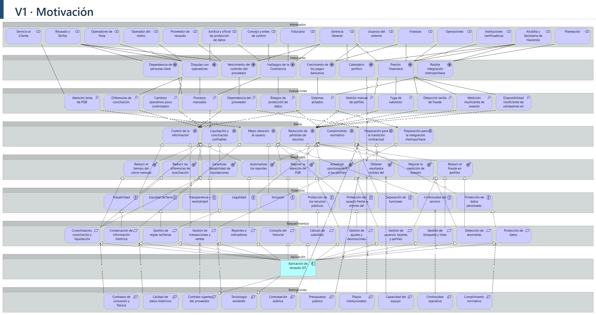

**Análisis.** La vista junta los 83 elementos del inventario de abajo (15 interesados, 8 impulsores, 12 evaluaciones, 7 metas, 9 resultados, 10 principios, 12 requerimientos y 10 restricciones) y la aplicación de recaudo, con 120 relaciones. Se lee de arriba hacia abajo. A la Gerencia General le importan los hallazgos de la Contraloría, el déficit y el calendario político; al área de Recaudo y Tarifas, el vencimiento del contrato del proveedor, las disputas con operadores y que la liquidación dependa de solo dos personas. Esos impulsores se ven en problemas concretos: el ente depende del proveedor para consultar su propia información (EVA01), la liquidación vive en Excel (EVA02) y los sistemas de recaudo, PQR, flota y finanzas no se hablan entre sí (EVA03). De ahí salen las metas, y la que la experta marcó como la más importante es poder demostrar cuánto dinero entró, por qué concepto y a quién se le pagó. Esa idea une MET01 (control de la información) y MET02 (liquidación y conciliación confiables), y es la que más requerimientos tiene detrás: REQ03 (consolidar, conciliar y liquidar) produce los resultados RES01 a RES03, que son el cierre en máximo 5 días, la diferencia sin explicar en máximo 0,1 % y el 100 % de liquidaciones trazables.

**Decisiones.** Las descripciones y el código de cada elemento (INT01, IMP01, etc.) se copiaron del inventario para que el modelo se pueda leer sin el README. Las cifras de los resultados son indicativas, porque la experta aclaró que la Gerencia todavía no las formaliza. MET07 (integración metropolitana) no tiene un resultado medible en la entrevista, así que la realiza directamente REQ01, el de intercambio de información. Las restricciones de proyecto, como el presupuesto, la contratación pública, los plazos y el tamaño del equipo, afectan a la meta o al resultado de transición (MET06 y RES09) y no a la aplicación, porque el software no las "cumple". Por el contrario, RESC01 y RESC02 (el contrato vigente del proveedor y las tarjetas que ya circulan) sí las realiza la aplicación al interoperar con la plataforma existente. La vista se dejó sin viewpoint porque mezcla motivación con un componente de aplicación. El detalle de cada relación está en [modelo/DECISIONES_MODELO.md](modelo/DECISIONES_MODELO.md).

### Inventario de elementos de motivación

> Inventario de los elementos de motivación identificados en la entrevista al experto del negocio del SIT, organizados en los ocho tipos: interesados, impulsores, evaluaciones, metas, resultados, principios, requerimientos y restricciones.

#### Interesados (Stakeholders)

Personas, áreas y entidades que tienen interés en el software de recaudo y en sus resultados.

| ID | Interesado | Interés o expectativa identificada en la entrevista |
|---|---|---|
| INT01 | Gerencia General | Tener control y transparencia sobre el recaudo y responder con evidencia ante la Alcaldía, el Concejo y los entes de control. |
| INT02 | Recaudo y Tarifas | Reducir la dependencia del proveedor y de Excel, y lograr liquidaciones y conciliaciones confiables, rápidas y trazables. |
| INT03 | Finanzas | Realizar cierres oportunos, disponer de cifras confiables, cobrar los subsidios y controlar la cartera. |
| INT04 | Servicio al Cliente | Consultar la información de tarjetas y usuarios para resolver reclamaciones en menos tiempo. |
| INT05 | Operaciones | Identificar validadores averiados, apoyar la detección de evasión y evitar errores de recaudo por cambios de ruta. |
| INT06 | Planeación | Obtener información confiable y oportuna sobre la demanda y el uso de los servicios. |
| INT07 | Jurídica y oficial de protección de datos | Cumplir las obligaciones legales de protección de datos y contar con evidencia para resolver disputas contractuales. |
| INT08 | Operadores de flota | Conocer cómo se calculan sus pagos, recibirlos oportunamente y reducir las reliquidaciones. |
| INT09 | Operador del metro | Contar con liquidaciones transparentes y oportunas, de acuerdo con su convenio particular. |
| INT10 | Proveedor de recaudo | Mantener la operación contratada y gestionar las solicitudes de información; su posición frente al cambio es ambigua. |
| INT11 | Alcaldía y Secretaría de Hacienda | Conocer el valor de los subsidios, su destinación y los recursos que deben aportar. |
| INT12 | Concejo y entes de control | Verificar la transparencia en el manejo de los recursos públicos. |
| INT13 | Usuarios del sistema | Obtener recargas oportunas, resolver reclamaciones rápidamente y acceder fácilmente a perfiles tarifarios. |
| INT14 | Instituciones certificadoras | Reducir el papeleo y disponer de un formato uniforme para reportar beneficiarios. |
| INT15 | Fiduciaria | Recibir instrucciones de pago claras, completas y debidamente soportadas. |

#### Impulsores (Drivers)

Factores que motivan a la organización a iniciar el proyecto en este momento.

| ID | Impulsor | Descripción |
|---|---|---|
| IMP01 | Vencimiento del contrato del proveedor | El contrato de recaudo vence en aproximadamente tres años y la organización necesita definir su estrategia antes de esa fecha. |
| IMP02 | Hallazgos de la Contraloría | La última auditoría identificó debilidades en la trazabilidad de las liquidaciones y en la dependencia de hojas de cálculo. |
| IMP03 | Disputas con operadores | Existen reclamaciones por diferencias en liquidaciones de años anteriores cuya evidencia fue difícil de reconstruir. |
| IMP04 | Presión financiera | El déficit del sistema está creciendo y la Alcaldía exige reducir la evasión y el fraude en subsidios antes de aportar más recursos. |
| IMP05 | Crecimiento de los pagos bancarios | Aumenta el uso de tarjetas bancarias, lo que exige una gestión más robusta de las transacciones y los cobros. |
| IMP06 | Posible integración metropolitana | Existe la perspectiva de integrar servicios con municipios vecinos, algo que la operación actual podría no soportar adecuadamente. |
| IMP07 | Calendario político | La administración actual termina a finales del próximo año y la Gerencia busca mostrar resultados concretos. |
| IMP08 | Dependencia de personas clave | La liquidación depende de dos personas del equipo, lo que representa un riesgo para la continuidad del proceso. |

#### Evaluaciones (Assessments)

Problemas, debilidades y valoraciones que describen la situación actual del negocio.

| ID | Evaluación | Situación identificada |
|---|---|---|
| EVA01 | Dependencia del proveedor | El ente gestor no tiene acceso directo y oportuno a toda la información detallada del recaudo. |
| EVA02 | Procesos manuales | La liquidación y parte de la conciliación dependen de archivos Excel, con riesgo de errores y poca trazabilidad. |
| EVA03 | Sistemas aislados | Los sistemas de recaudo, PQR, flota y finanzas no están integrados adecuadamente. |
| EVA04 | Diferencias de conciliación | La diferencia sin explicar está entre el 0,2 % y el 0,3 % del recaudo mensual, por encima de la meta del 0,1 %. |
| EVA05 | Atención lenta de PQR | La falta de información integrada retrasa la resolución de reclamaciones de los usuarios. |
| EVA06 | Gestión manual de perfiles | Las instituciones entregan archivos con formatos distintos y los retiros de beneficiarios no siempre se reportan oportunamente. |
| EVA07 | Fuga de subsidios | Algunos usuarios conservan beneficios después de perder el derecho a ellos. |
| EVA08 | Detección tardía de fraude | Las investigaciones dependen de extractos del proveedor y análisis manuales. |
| EVA09 | Cambios operativos poco controlados | Las modificaciones de rutas y tarifas pueden ocasionar errores de configuración y liquidación. |
| EVA10 | Medición insuficiente de evasión | La evasión se estima mediante muestreos realizados pocas veces al año y con poca desagregación. |
| EVA11 | Riesgos de protección de datos | La organización reconoce debilidades en el control de la información personal que debe proteger. |
| EVA12 | Disponibilidad insuficiente de validadores en flota | La disponibilidad actual ronda el 96 %, frente a una meta de al menos el 98 %. |

#### Metas (Goals)

Estados futuros que la organización quiere alcanzar mediante el proyecto.

| ID | Meta | Descripción |
|---|---|---|
| MET01 | Control de la información | Conseguir que el ente gestor tenga control y acceso a la información del recaudo. |
| MET02 | Liquidación y conciliación confiables | Calcular y conciliar los valores con rapidez, precisión y trazabilidad. |
| MET03 | Mejor atención al usuario | Reducir los tiempos de respuesta relacionados con tarjetas, pagos, perfiles y reclamaciones. |
| MET04 | Reducción de pérdidas de recursos | Disminuir las pérdidas asociadas al fraude en perfiles, fallas de validadores y cartera bancaria, y mejorar la medición de la evasión. |
| MET05 | Cumplimiento normativo | Cumplir las obligaciones sobre protección de datos, reportes y control de los recursos. |
| MET06 | Preparación para la transición contractual | Contar con información y procesos bajo control antes de decidir el futuro del contrato del proveedor. |
| MET07 | Preparación para la integración metropolitana | Mejorar la capacidad de intercambio de información y gestión ante una eventual integración con municipios vecinos. |

#### Resultados (Outcomes)

Resultados observables y medibles que permitirían evaluar el éxito del proyecto. Según la entrevista, estas metas son indicativas y todavía no han sido formalizadas por la Gerencia.

| ID | Resultado esperado | Meta propuesta en la entrevista | Plazo indicado |
|---|---|---|---|
| RES01 | Reducir el tiempo del cierre mensual | Pasar de 8–10 días hábiles a un máximo de 5 días hábiles. | 12 meses después de entrar en operación. |
| RES02 | Reducir las diferencias de conciliación sin explicar | Llegar a un máximo del 0,1 %, frente al 0,2–0,3 % actual. | 12 meses. |
| RES03 | Garantizar trazabilidad de liquidaciones | Alcanzar el 100 % de liquidaciones trazables y reconstruibles, sin depender de Excel. | Primer cierre bajo el nuevo esquema. |
| RES04 | Mejorar la atención de PQR | Alcanzar un promedio máximo de 5 días hábiles, frente a los aproximadamente 10 días actuales. | Entre 6 y 12 meses. |
| RES05 | Actualizar oportunamente los perfiles | Reflejar al mes siguiente el retiro de quienes pierdan el derecho al beneficio. | No se especifica un plazo adicional. |
| RES06 | Reducir el fraude en perfiles | Conseguir una disminución medible del fraude asociado a perfiles tarifarios. | Primer año. |
| RES07 | Mejorar la medición de evasión | Medirla mensualmente por ruta y estación, en lugar de hacerlo solo unas pocas veces al año. | No se especifica un plazo. |
| RES08 | Automatizar los reportes | Generar los reportes para entidades de control sin trabajo manual. | No se especifica un plazo. |
| RES09 | Obtener resultados visibles del proyecto | Mostrar resultados concretos y verificables. | Entre 12 y 18 meses y, en todo caso, antes del vencimiento del contrato del proveedor. |

#### Principios (Principles)

Criterios que deben orientar las decisiones y el funcionamiento del software.

| ID | Principio | Aplicación en el negocio |
|---|---|---|
| PRI01 | Equidad tarifaria | Usuarios con el mismo perfil deben recibir el mismo tratamiento tarifario, independientemente del canal, ruta u operador. |
| PRI02 | Legalidad | Las reglas tarifarias deben estar respaldadas por actos administrativos y aplicarse según su vigencia. |
| PRI03 | Transparencia y neutralidad | Los operadores deben liquidarse conforme a sus contratos y poder verificar cómo se calculan sus pagos. |
| PRI04 | Trazabilidad | Cada peso debe poder rastrearse desde la recarga o el viaje hasta el giro correspondiente. |
| PRI05 | Protección de los recursos públicos | El dinero del recaudo debe administrarse mediante el patrimonio autónomo y conforme a las reglas contractuales. |
| PRI06 | Separación de funciones | La persona o área que liquida no debe ser la misma que aprueba ni la que ejecuta el giro. |
| PRI07 | Continuidad del servicio | Las fallas del sistema no deben dejar a los usuarios sin posibilidad de viajar. |
| PRI08 | Protección del usuario frente a errores del sistema | En casos pequeños y razonables, debe darse al usuario el beneficio de la duda según las reglas aplicables. |
| PRI09 | Protección de datos personales | Solo deben tratarse los datos necesarios, con las autorizaciones y medidas de protección correspondientes. |
| PRI10 | Inclusión | Debe existir una alternativa de pago para quienes no tienen cuenta bancaria ni teléfono inteligente. |

#### Requerimientos (Requirements)

Funciones y capacidades que el software debe proporcionar para satisfacer las necesidades del negocio.

| ID | Requerimiento | Descripción |
|---|---|---|
| REQ01 | Gestión de transacciones y ventas | Recibir y consultar la información de transacciones, recargas y ventas de forma completa y oportuna, incluidas las extemporáneas. |
| REQ02 | Gestión de reglas tarifarias | Definir y mantener tarifas, perfiles, transbordos, límites y vigencias, conservando su historial. |
| REQ03 | Consolidación, conciliación y liquidación | Consolidar y conciliar información y liquidar valores por modo, ruta y operador, con trazabilidad y ajustes a periodos cerrados. |
| REQ04 | Cálculo de subsidios | Calcular el valor de los subsidios que deben solicitarse a la Alcaldía. |
| REQ05 | Gestión de usuarios, tarjetas y perfiles | Gestionar titulares, tarjetas, certificaciones, perfiles especiales y vencimientos. |
| REQ06 | Gestión de bloqueos y listas | Registrar las decisiones de bloqueo o desbloqueo, sus responsables y sus motivos. |
| REQ07 | Consulta del historial | Permitir consultar el historial completo de una tarjeta para atender reclamaciones. |
| REQ08 | Gestión de ajustes y devoluciones | Registrar solicitudes, gestionar aprobaciones según el monto y realizar seguimiento a ajustes y devoluciones. |
| REQ09 | Protección de datos | Gestionar autorizaciones y solicitudes de consulta, rectificación y supresión de datos conforme a las obligaciones aplicables. |
| REQ10 | Reportes e indicadores | Generar reportes obligatorios e indicadores para la Gerencia y las entidades correspondientes. |
| REQ11 | Detección de anomalías | Generar alertas sobre comportamientos anómalos y posibles fraudes. |
| REQ12 | Conservación de información histórica | Conservar información durante los periodos exigidos por las normas y los contratos para respaldar auditorías y disputas. |

#### Restricciones (Constraints)

Condiciones legales, contractuales, tecnológicas, financieras y operativas que limitan las alternativas de solución.

| ID | Restricción | Descripción |
|---|---|---|
| RESC01 | Contrato vigente del proveedor | Los validadores, la plataforma de transacciones y los canales de recarga continúan bajo responsabilidad del proveedor, al menos hasta el vencimiento contractual. |
| RESC02 | Tecnología existente | No se pueden reemplazar libremente los validadores ni las tarjetas VAMOS que ya están en circulación. |
| RESC03 | Presupuesto público | El presupuesto requiere aprobación anual. La cifra disponible para el proyecto no está definida en la entrevista. |
| RESC04 | Contratación pública | Las adquisiciones deben cumplir las normas de contratación estatal y sus procedimientos. |
| RESC05 | Cumplimiento normativo | La solución debe considerar la protección de datos personales, los requisitos de seguridad de pagos aplicables, las reglas de la fiducia y los reportes obligatorios. |
| RESC06 | Contratos de concesión y fiducia | El software no puede modificar unilateralmente las fórmulas de remuneración ni la prelación contractual de pagos. |
| RESC07 | Plazos institucionales | El proyecto debe considerar el fin de la administración actual y el vencimiento del contrato del proveedor. |
| RESC08 | Capacidad del equipo | El área de Recaudo y Tarifas es pequeña y no puede abandonar la operación cotidiana durante la implementación. |
| RESC09 | Continuidad operativa | La transición al nuevo sistema no puede detener el servicio de transporte. |
| RESC10 | Calidad de datos históricos | Los datos históricos presentan calidad irregular, lo que puede dificultar la migración, conciliación y reconstrucción de operaciones. |

#### Síntesis

El inventario muestra que el proyecto surge principalmente de la necesidad de recuperar el control de la información del recaudo, mejorar la trazabilidad financiera y reducir la dependencia del proveedor y de procesos manuales.

Los interesados requieren información confiable y oportuna; los impulsores evidencian presiones contractuales, financieras y de auditoría; las evaluaciones describen debilidades actuales; las metas y los resultados establecen mejoras esperadas; y los principios, requerimientos y restricciones delimitan cómo debe desarrollarse e implementarse la solución.

La meta prioritaria expresada por la experta es que el ente gestor pueda demostrar con certeza cuánto dinero entró, por qué concepto y a quién se pagó.

## 3. Mapa de capacidades y proceso E2E
### V2 Mapa de capacidades
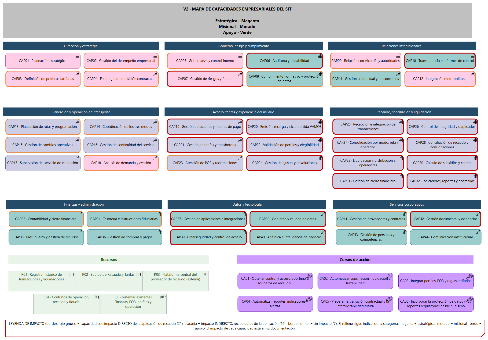

**Análisis.** El mapa cubre a todo el ente gestor y no solo al recaudo, como pide la diapositiva 35 de 7_SOA. Tiene 44 capacidades repartidas en 9 grupos, y los colores separan las tres categorías que usó la experta al hablar de las funciones del ente: estratégicas (magenta), misionales (morado) y de apoyo (verde). Las estratégicas son Dirección y estrategia, Gobierno, riesgo y cumplimiento, y Relaciones institucionales. Las misionales son Planeación y operación del transporte, Acceso, tarifas y experiencia del usuario, y Recaudo, conciliación y liquidación. Las de apoyo son Finanzas y administración, Datos y tecnología, y Servicios corporativos. Al lado van 5 recursos (el registro histórico de transacciones y liquidaciones, el equipo de Recaudo y Tarifas, la plataforma central del proveedor, los contratos de operación, recaudo y fiducia, y los sistemas existentes) y 6 cursos de acción que se conectan con las metas de V1.

**Capacidades impactadas.** Cada capacidad trae en su documentación el impacto que le asignamos. De las 44, 20 tienen impacto directo, 17 indirecto y 7 ninguno. Las directas son las que la aplicación ejecuta o automatiza: gestión de usuarios y medios de pago (CAP19), emisión, recarga y ciclo de vida de VAMOS (CAP20), tarifas y transbordos (CAP21), perfiles y elegibilidad (CAP22), toda la cadena desde la recepción de transacciones (CAP25) hasta la liquidación (CAP29), los subsidios (CAP30) y los indicadores (CAP32), además de varias de gobierno y de datos como auditoría y trazabilidad (CAP06), riesgos y fraude (CAP07) y ciberseguridad (CAP39). Las indirectas son las que mejoran porque reciben datos de la aplicación pero no la usan para ejecutarse, por ejemplo la atención de PQR (CAP23), la contabilidad (CAP33) y la tesorería (CAP34). Las que quedan sin impacto, como la supervisión del servicio de validación (CAP17), la gestión de compras y pagos (CAP36) o la comunicación institucional (CAP44), están cerca del recaudo pero fuera de lo que cubre el software.

**Decisiones.** Una capacidad dice qué sabe hacer el ente, no qué área lo hace; por eso la personalización de tarjetas, aunque la ejecuta Servicio al Cliente, cuenta como parte del recaudo. La planeación de rutas queda con impacto indirecto: el software solo consume su catálogo de rutas para aplicar transbordos y liquidar, no diseña rutas. La operación de validadores y dispositivos es IoT y está fuera del alcance, así que ninguna capacidad la hace directa. El recurso de la plataforma del proveedor se marca como externo para no asumir que el ente la poseerá ni que se reemplazará antes de que venza el contrato.

### V3 Cadena de valor y proceso E2E
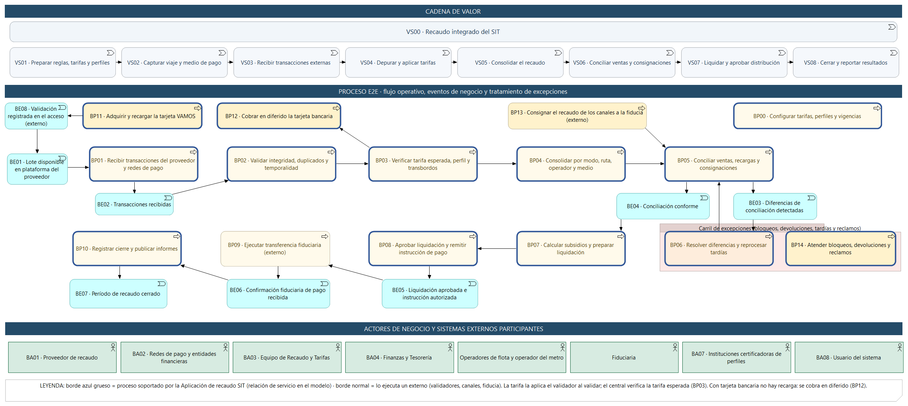

**Análisis:** _…_

## 4. Descomposición de servicios
### V4 Descomposición de servicios
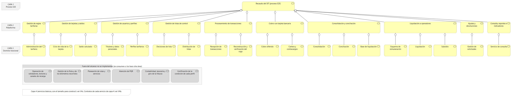

**Análisis.** La vista baja el proceso E2E de recaudo en tres niveles. Arriba está el servicio de extremo a extremo. Debajo hay 10 servicios de plataforma que se implementan, cada uno ligado a los requerimientos de V1 que realiza (por ejemplo, la liquidación a operadores realiza REQ03 y REQ04), y debajo de ellos 19 servicios de dominio funcional. En amarillo está lo que se construye y en gris lo que queda fuera del alcance: seis servicios de plataforma, entre ellos la operación de validadores (IoT), la atención de PQR y la contabilidad y el giro de la fiducia. La cuarta capa, con los 52 servicios básicos que tienen el tamaño para construirse y los 8 que se descartan, está en V4c. La V4d muestra quién hace cada cosa: los roles del ente gestor, las funciones que realizan los servicios de plataforma y los objetos de negocio que manejan.

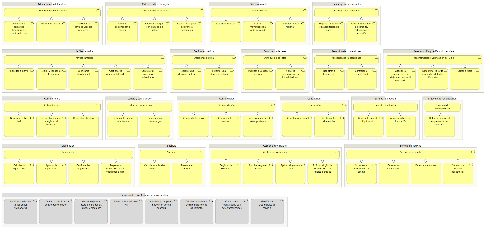

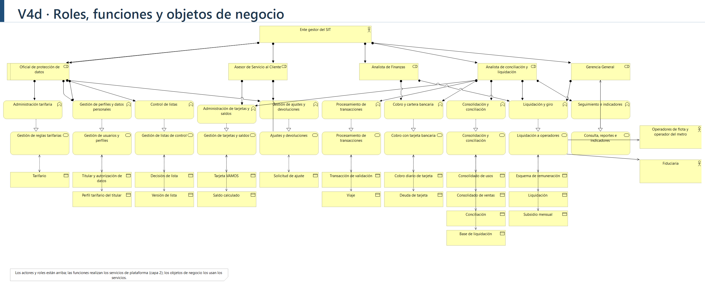

**Decisiones.** Se usó la relación de agregación entre capas porque un servicio de una capa se compone de los de la inferior sin ser su dueño exclusivo. El servicio de consulta, reportes e indicadores (P10) se dejó como un servicio de plataforma propio, aunque se alimenta de los demás, porque tiene usuarios y reglas propias (permisos de consulta, indicadores y reportes obligatorios). En DDD corresponde al dominio genérico DOM10 (§5): no es la fuente de verdad de ningún dato, solo lee lo que producen los dominios operacionales. La liquidación a operadores (P8) sí se incluye, pero solo aplica las fórmulas de cada contrato y no las decide, porque el software no puede modificar unilateralmente las reglas de remuneración (RESC06).

#### Descomposición del proceso E2E en capas

Partimos del proceso E2E de recaudo, tal como lo corrigió la experta (pregunta 2.9): adquirir el medio de pago, cargar saldo (solo VAMOS), validar, transmitir las transacciones, cobrar al banco de forma diferida (solo tarjeta bancaria), consignar a la fiducia, consolidar, conciliar, liquidar y girar, más un carril de excepciones para bloqueos, devoluciones, transacciones tardías y reclamos. Lo bajamos con las capas de la diapositiva 28 de 7_SOA: (1) proceso E2E, (2) servicios de negocio de plataforma, (3) servicios de dominio funcional, (4) servicios básicos de subdominio, que son los que tienen el tamaño para construirse, y (5) la capa anticorrupción, que aparece en la última tabla de esta sección.

Para decidir en qué capa va cada servicio usamos las preguntas de la diapositiva 33. Por ejemplo, con "determinar la tarifa esperada de un viaje": la responsabilidad es de Recaudo y Tarifas, se usa al verificar cada viaje y al calcular el cobro bancario diferido, los datos los gestiona el procesamiento de transacciones, las reglas las define el tarifario por acto administrativo y el conocimiento está en quien publica ese tarifario. Un servicio de plataforma agrupa varios servicios de dominio que el proceso E2E orquesta; uno de dominio funcional tiene un solo dueño de datos y de reglas.

| Plataforma (L2) | Dominio funcional (L3) | Servicios básicos (L4) | Capacidad en V2 |
|---|---|---|---|
| P1 Gestión de reglas tarifarias | Administración del tarifario | Definir tarifas, reglas de transbordo y límites de uso · Publicar el tarifario · Consultar el tarifario vigente por fecha | CAP21 |
| P2 Gestión de tarjetas y saldos | Ciclo de vida de la tarjeta | Emitir y personalizar la tarjeta · Reponer la tarjeta con traslado de saldo · Retirar las tarjetas de primera generación | CAP19, CAP20 |
|  | Saldo calculado | Registrar recargas · Aplicar movimientos al saldo calculado · Consultar saldo e historial | CAP20 |
| P3 Gestión de usuarios y perfiles | Titulares y datos personales | Registrar el titular y su autorización de datos · Atender solicitudes de consulta, rectificación y supresión | CAP08, CAP19 |
|  | Perfiles tarifarios | Solicitar el perfil · Recibir y validar las certificaciones · Verificar la elegibilidad · Gestionar la vigencia del perfil · Controlar el consumo subsidiado | CAP22 |
| P4 Gestión de listas de control | Decisiones de lista | Registrar una decisión de lista · Levantar una decisión de lista | CAP07 |
|  | Distribución de listas | Publicar la versión de lista · Vigilar la sincronización de los validadores | CAP07, CAP37 |
| P5 Procesamiento de transacciones | Recepción de transacciones | Registrar la transacción · Controlar la completitud | CAP25, CAP26 |
|  | Reconstrucción y verificación del viaje | Asociar la validación a un viaje y reconocer el transbordo · Determinar la tarifa esperada y detectar diferencias · Cerrar el viaje | CAP21, CAP26 |
| P6 Cobro con tarjeta bancaria | Cobro diferido | Generar el cobro diario · Enviar al adquirente y registrar el resultado · Reintentar el cobro | CAP19, CAP30 |
|  | Cartera y contracargos | Gestionar la deuda de la tarjeta · Gestionar los contracargos | CAP30 |
| P7 Consolidación y conciliación | Consolidación | Consolidar los usos · Consolidar las ventas · Incorporar ajustes extemporáneos | CAP27 |
|  | Conciliación | Conciliar por capa · Gestionar las diferencias | CAP28 |
|  | Base de liquidación | Generar la base de liquidación · Aprobar la base de liquidación | CAP27, CAP29 |
| P8 Liquidación a operadores | Esquema de remuneración | Definir y publicar el esquema de un contrato | CAP29 |
|  | Liquidación | Calcular la liquidación · Aprobar la liquidación · Gestionar las objeciones · Preparar la instrucción de giro y registrar el giro | CAP29, CAP34 |
|  | Subsidio | Calcular el subsidio mensual · Presentar el subsidio | CAP30 |
| P9 Ajustes y devoluciones | Gestión de solicitudes | Registrar la solicitud · Aprobar según el monto · Aplicar el ajuste a favor · Solicitar el giro de devolución o el reverso bancario | CAP24 |
| P10 Consulta, reportes e indicadores | Servicio de consulta | Consultar el historial de la tarjeta · Generar los indicadores · Detectar anomalías · Generar los reportes obligatorios | CAP10, CAP32, CAP40 |

#### Tabla de inclusión y exclusión

Los 52 servicios de capa 4 de la tabla de arriba se implementan todos, porque cada uno responde a una necesidad del alcance o de un requerimiento de V1. Abajo justificamos el nivel de plataforma y de dominio, y los servicios que dejamos fuera, incluidos los de capa 4.

| Capa | Servicio | ¿Se implementa? | Justificación |
|---|---|---|---|
| L2 | P1 Gestión de reglas tarifarias | Sí | El alcance pide tarifas y perfiles, y REQ02 lo exige con vigencias e historial. |
| L2 | P2 Gestión de tarjetas y saldos | Sí | El alcance incluye emisión, recargas, consulta de saldo y bloqueo de VAMOS. |
| L2 | P3 Gestión de usuarios y perfiles | Sí | El alcance pide validar que la persona cumple su perfil; además REQ05 y REQ09 (datos personales). |
| L2 | P4 Gestión de listas de control | Sí | La experta quiere que la decisión de bloquear o permitir sea del ente y quede con responsable y motivo (REQ06). |
| L2 | P5 Procesamiento de transacciones | Sí | El enunciado dice que el software recibe las transacciones y aplica la tarifa correcta; REQ01. |
| L2 | P6 Cobro con tarjeta bancaria | Sí | Es el medio de pago de los visitantes y su flujo es distinto al de VAMOS (cobro diferido). |
| L2 | P7 Consolidación y conciliación | Sí | Está en el alcance y es la meta principal de la experta. REQ03. |
| L2 | P8 Liquidación a operadores | Sí | REQ03 y REQ04; en V2 las capacidades de liquidación y subsidios tienen impacto directo. El software aplica las fórmulas de cada contrato pero no las decide (RESC06). |
| L2 | P9 Ajustes y devoluciones | Sí | REQ08; sin esto un reclamo de saldo no se puede cerrar. |
| L2 | P10 Consulta, reportes e indicadores | Sí | REQ07, REQ10 y REQ11; ataca la atención lenta de PQR (EVA05) y la poca medición de evasión (EVA10). |
| L2 | Operación de validadores, lectores y canales de recarga | No | Es IoT y dispositivos, fuera del alcance. La opera el proveedor (RESC01); solo recibimos lo que generan. |
| L2 | Gestión de la flota y los kilómetros recorridos | No | Es de Operaciones. Los kilómetros se consumen para conciliar y liquidar. |
| L2 | Planeación de rutas y servicios | No | Es de Planeación. Se consume el catálogo de rutas y estaciones. |
| L2 | Atención de PQR | No | Está en el sistema de Servicio al Cliente. El software le da el historial de la tarjeta y recibe las solicitudes de ajuste. |
| L2 | Contabilidad, tesorería y giro de la fiducia | No | Son de Finanzas y de la fiducia. El software entrega la liquidación y la instrucción de giro soportada. |
| L2 | Certificación de la condición de cada perfil | No | La hacen colegios, universidades y entidades de salud. El software recibe y valida sus listados. |
| L3 | Todos los de la tabla de capas | Sí | Cada uno tiene un dueño claro de datos y reglas dentro de una plataforma incluida. |
| L4 | Publicar la tabla de tarifas en los validadores | No | Lo ejecuta el proveedor. El software le entrega el tarifario por la capa anticorrupción. |
| L4 | Actualizar las listas dentro del validador | No | Igual: entregamos la versión de lista y el proveedor la distribuye. |
| L4 | Vender tarjetas y recargar en taquillas, tiendas y máquinas | No | Son canales del proveedor. El software solo registra la venta y la consignación. |
| L4 | Detectar la evasión en vía | No | La experta fue clara (H14): el control es físico, de Operaciones y la Policía. El software mide e identifica anomalías. |
| L4 | Autorizar y compensar pagos con tarjeta bancaria | No | Lo hace el adquirente. El software le envía el cobro y recibe el resultado. |
| L4 | Calcular las fórmulas de remuneración de los contratos | No | Las definen Finanzas y Jurídica y cambian por contrato (H02). El software las parametriza pero no las modifica. |
| L4 | Cruce con la Registraduría para detectar fallecidos | No | Hoy no existe ese cruce; queda como mejora futura. |
| L4 | Gestión de credenciales de servicio | No (por decidir) | La experta la mencionó como débil, pero el enunciado no la pide. Es una pregunta abierta del boceto del mapa de capacidades. |

#### Contratos de servicio (contract-first)

Cada servicio básico de la capa 4 tiene su contrato como objeto *Contract* en el modelo (vista V4b), con los mismos datos de esta tabla en su documentación. Los requisitos no funcionales salen de lo que dijo la experta (por ejemplo las 48 horas de llegada de transacciones, la espera de 48 horas para trasladar saldo o la meta de diferencia de conciliación) y de las reglas de protección de datos.

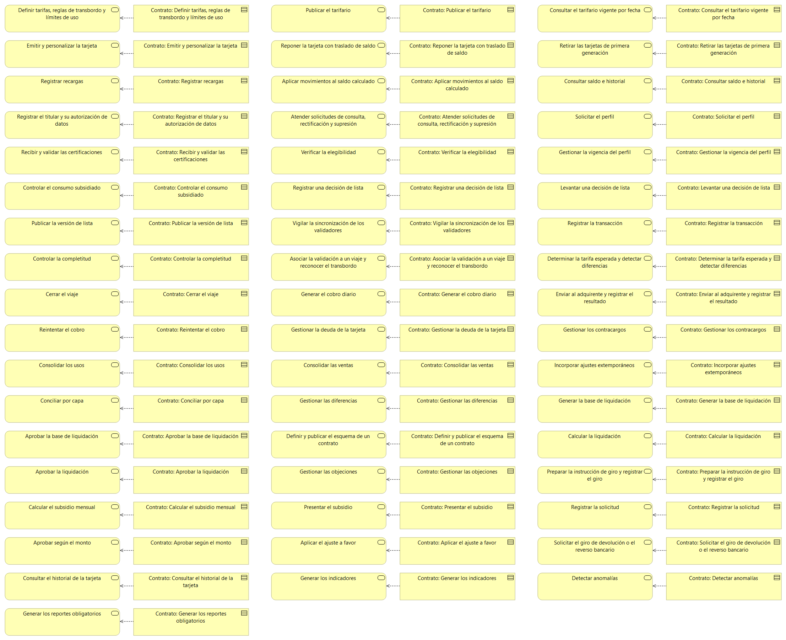

| Servicio | Entradas | Salidas | Errores | Requisitos no funcionales |
|---|---|---|---|---|
| Definir tarifas, reglas de transbordo y límites de uso | Perfil tarifario, valor o descuento, ventana de transbordo, máximo de transbordos, valor del 1.er y 2.º transbordo, límite mensual de viajes subsidiados y vigencia. | Borrador de tarifario con su número de versión. | Descuento fuera de 0 a 100 %; falta la tarifa plena; vigencia incompleta. | Conserva todas las versiones; registra quién cambió qué y cuándo. |
| Publicar el tarifario | Versión del tarifario, acto administrativo y fecha de vigencia. | Tarifario publicado, inmutable, y entrega al proveedor por la capa anticorrupción. | Sin acto administrativo; vigencia que se traslapa con otra; versión incompleta. | Inmutable una vez publicado; se entrega con días de anticipación a su vigencia. |
| Consultar el tarifario vigente por fecha | Fecha y hora, perfil tarifario. | Tarifa, reglas de transbordo y límites que regían en esa fecha. | Fecha sin tarifario vigente. | Responde con la regla de la fecha de la validación y no con la de llegada de la transacción. |
| Emitir y personalizar la tarjeta | Tipo (al portador o personalizada), documento del titular y su autorización de datos si es personalizada, canal. | Tarjeta emitida con su número y su estado. | Titular sin autorización de datos; tarjeta ya emitida. | Protege los datos personales (Ley 1581 de 2012). |
| Reponer la tarjeta con traslado de saldo | Número de la tarjeta bloqueada e identidad verificada del titular. | Tarjeta nueva y orden de traslado del saldo calculado. | Tarjeta al portador (no se repone); no han pasado las 48 horas de espera. | Espera unas 48 horas para que lleguen las transacciones pendientes. |
| Retirar las tarjetas de primera generación | Número de tarjeta y tarjeta nueva de reemplazo. | Tarjeta retirada y bloqueada, con el saldo respetado. | Tarjeta ya retirada. | Una tarjeta retirada no se puede reactivar. |
| Registrar recargas | Tarjeta, valor, canal y referencia de la venta. | Recarga registrada; si viene de la app o la web queda pendiente de aplicar. | Valor menor a $2.000; saldo que superaría $200.000; tarjeta bloqueada. | Idempotente por la referencia de la venta. |
| Aplicar movimientos al saldo calculado | Transacción con el consecutivo de la tarjeta y su valor. | Saldo calculado actualizado. | Salto de consecutivo (se reporta como diferencia); saldo por debajo de menos una tarifa. | Se aplican en orden de consecutivo; las diferencias se investigan como posible fraude. |
| Consultar saldo e historial | Tarjeta. | Saldo calculado, recargas pendientes, estado y últimos movimientos. | Tarjeta inexistente. | Respuesta en línea para Servicio al Cliente; aclara que el saldo real está en la tarjeta. |
| Registrar el titular y su autorización de datos | Documento, datos de contacto y autorización (del acudiente si es menor). | Titular registrado con autorización vigente. | Menor sin acudiente; autorización incompleta. | Solo los datos necesarios; los de salud con acceso restringido. |
| Atender solicitudes de consulta, rectificación y supresión | Titular y tipo de solicitud. | Respuesta y registro de lo que se hizo. | Titular no verificado; dato que la ley obliga a conservar. | Deja evidencia y respeta los plazos de ley. |
| Solicitar el perfil | Titular, tarjeta personalizada, tipo de perfil y soportes. | Solicitud en verificación. | Tarjeta al portador; el titular ya tiene un perfil activo. | Trazable por titular. |
| Recibir y validar las certificaciones | Listados de las instituciones y certificados. | Certificaciones aceptadas o rechazadas, con su motivo. | Formato no reconocido; titular no encontrado. | Soporta formatos distintos por institución y los picos de enero y julio. |
| Verificar la elegibilidad | Solicitud con su certificación. | Elegible o no, con la vigencia. | Certificación vencida; institución que no responde. | Aplica la regla de cada perfil (edad, matrícula, discapacidad). |
| Gestionar la vigencia del perfil | Perfil, evento (activar, vencer o retirar) y motivo. | Perfil actualizado y novedad para los validadores. | Retiro sin motivo. | Al vencer, la tarjeta sigue a tarifa plena; avisa el vencimiento. |
| Controlar el consumo subsidiado | Validación con tarifa especial. | Contador mensual de viajes subsidiados. | Validación ya contada. | No cuenta los transbordos gratuitos; el límite ronda los 50 viajes al mes. |
| Registrar una decisión de lista | Tarjeta o identificación técnica, lista (bloqueo o denegación), motivo y responsable. | Decisión registrada y orden de publicar. | Sin motivo o sin responsable; bloqueo por pérdida de una tarjeta al portador. | Auditable: nada se borra. |
| Levantar una decisión de lista | Decisión, motivo y quien autoriza. | Decisión levantada y orden de publicar. | Bloqueo por pérdida (no se reversa); quien levanta no tiene permiso. | Solo Recaudo y Tarifas levanta bloqueos por fraude. |
| Publicar la versión de lista | Decisiones nuevas. | Versión numerada entregada al proveedor. | Versión con salto de número. | Inmutable una vez publicada. |
| Vigilar la sincronización de los validadores | Reportes de sincronización por validador. | Validadores desactualizados (más de unas 48 horas) señalados. | Validador que no reporta. | Alerta oportuna a Operaciones. |
| Registrar la transacción | Transacción del validador: medio de pago, perfil, fecha y hora, validador, ruta, operador, tipo, valor, saldo antes y después y consecutivo. | Transacción registrada, o marcada como duplicada o extemporánea. | Transacción incompleta; ruta inexistente. | Idempotente por validador y consecutivo; acepta llegadas de hasta 48 horas. |
| Controlar la completitud | Contadores de cierre del validador y transacciones recibidas. | Informe de completitud por validador y por día. | Contador sin transacciones. | Mide el 99 % recibido en 24 horas y el 100 % en 48 horas. |
| Asociar la validación a un viaje y reconocer el transbordo | Transacción y viaje abierto del medio de pago. | Viaje actualizado; transbordo reconocido o no. | Transbordo en la misma ruta o estación; más de 2 transbordos; fuera de los 90 minutos. | Tolera llegadas desordenadas y reconstruye el viaje. |
| Determinar la tarifa esperada y detectar diferencias | Viaje, perfil y tarifario de la fecha. | Tarifa esperada y diferencia con lo cobrado. | Perfil o tarifario no encontrado. | Usa la regla vigente en la fecha de la validación. |
| Cerrar el viaje | Viaje con la ventana vencida. | Viaje cerrado, listo para el cobro bancario y la consolidación. | Viaje ya cerrado. | Una vez cerrado solo cambia con un ajuste. |
| Generar el cobro diario | Viajes cerrados por identificación técnica de la tarjeta y fecha. | Cobro diario (siempre tarifa plena, con los transbordos aplicados). | Cobro ya generado para esa tarjeta y fecha. | No almacena el número completo de la tarjeta. |
| Enviar al adquirente y registrar el resultado | Cobro diario. | Cobro aprobado o rechazado. | Adquirente no disponible (se acumula y se reintenta); tarjeta inválida. | Envío en la madrugada; PCI DSS a través del adquirente. |
| Reintentar el cobro | Cobro rechazado. | Cobro aprobado o rechazo definitivo. | Se superaron los 3 intentos. | Alrededor de 3 intentos durante algunos días. |
| Gestionar la deuda de la tarjeta | Rechazo definitivo o pago del usuario. | Deuda registrada o saldada, con la orden de denegar o de levantar la denegación. | Pago parcial; deuda ya saldada. | La cartera se castiga tras el plazo; la meta es una cartera no cobrada menor al 1 %. |
| Gestionar los contracargos | Contracargo notificado por el adquirente. | Respuesta con la evidencia de los toques. | Plazo vencido. | Conserva la evidencia de los toques. |
| Consolidar los usos | Transacciones y periodo. | Líneas por modo, ruta, operador y tipo de tarifa. | Transacción de un periodo ya cerrado (entra como ajuste). | Cuadre: la suma de las líneas es igual al total del periodo. |
| Consolidar las ventas | Ventas y consignaciones por canal y punto. | Líneas por canal, punto y medio de pago, con sus diferencias. | Consignación mayor a lo vendido. | Diaria. |
| Incorporar ajustes extemporáneos | Transacción tardía de un periodo cerrado. | Ajuste en el periodo abierto con su periodo de origen. | Sin periodo de origen. | Trazable hasta la transacción original. |
| Conciliar por capa | Capa (ventas contra consignaciones, transacciones contra el proveedor, usos contra kilómetros, con el operador) y periodo. | Diferencias detectadas. | Falta un insumo, por ejemplo los kilómetros. | Meta de diferencia sin explicar del 0,1 % o menos. |
| Gestionar las diferencias | Diferencia, explicación y responsable. | Diferencia explicada o pendiente. | Diferencia sin responsable. | No se cierra un periodo con diferencias sin clasificar. |
| Generar la base de liquidación | Periodo cerrado y conciliado. | Base por modo, ruta y operador con huella de integridad. | Periodo abierto o con diferencias sin clasificar. | Inmutable. |
| Aprobar la base de liquidación | Base y aprobador. | Base aprobada. | El aprobador es quien la generó. | Separación de funciones. |
| Definir y publicar el esquema de un contrato | Contrato, reglas (kilómetros, pasajeros, indicadores), prelación de pagos y vigencia. | Esquema vigente y versionado. | Vigencia que se traslapa; regla sin fuente de dato. | Un esquema vigente no se modifica: cada cambio es una versión con soporte contractual. |
| Calcular la liquidación | Base aprobada, kilómetros certificados, esquema vigente y tipo (preliminar semanal o definitiva mensual). | Liquidación por beneficiario con el origen de cada valor. | Faltan los kilómetros certificados. | Cada valor se reconstruye desde sus insumos, sin depender de Excel. |
| Aprobar la liquidación | Liquidación y aprobador. | Liquidación aprobada. | El aprobador es quien liquidó. | Separación de funciones. |
| Gestionar las objeciones | Objeción del operador y línea objetada. | Objeción registrada y resuelta. | Fuera del plazo. | Suspende solo la línea objetada. |
| Preparar la instrucción de giro y registrar el giro | Liquidación aprobada. | Instrucción soportada para la Gerencia y giro confirmado por la fiducia. | El giro no respeta la prelación de pagos. | Trazable desde el peso pagado hasta su origen. |
| Calcular el subsidio mensual | Periodo de usos cerrado. | Valor a cobrar por viajes con tarifa especial. | Periodo abierto. | Calculado sobre datos cerrados. |
| Presentar el subsidio | Subsidio calculado. | Subsidio presentado a Hacienda. | Subsidio ya presentado (las diferencias van como ajuste). | Inmutable una vez presentado. |
| Registrar la solicitud | Referencia a la PQR, tipo (ajuste a favor, devolución en dinero, reverso bancario o traslado de saldo), monto, causa y evidencias. | Solicitud registrada. | Sin PQR de referencia. | Conserva las evidencias. |
| Aprobar según el monto | Solicitud y aprobador. | Solicitud aprobada o rechazada. | El aprobador no tiene nivel para ese monto; quien registra la solicitud intenta aprobarla. | Hasta $50.000 con causa clara aprueba Servicio al Cliente; el resto, Recaudo y Tarifas. |
| Aplicar el ajuste a favor | Solicitud aprobada. | Ajuste cargado como recarga pendiente de la tarjeta. | Ajuste ya aplicado. | Se aplica una sola vez y entra a la conciliación del mes. |
| Solicitar el giro de devolución o el reverso bancario | Solicitud aprobada y certificación bancaria. | Orden a Finanzas o al adquirente. | Sin certificación bancaria. | Una devolución en dinero tarda de dos a cuatro semanas. |
| Consultar el historial de la tarjeta | Tarjeta y rango de fechas. | Validaciones, recargas, ajustes, rechazos, estado, perfil y viajes subsidiados del mes. | Sin permiso. | Respuesta en línea; no muestra datos personales a quien no los necesita. |
| Generar los indicadores | Periodo y filtros por operador, ruta o modo. | Indicadores de recaudo: evasión estimada, completitud, diferencia de conciliación, cierre y PQR. | Faltan insumos. | Sin armarlos a mano. |
| Detectar anomalías | Validaciones, conteos de pasajeros y saldos. | Alertas: baja validación, diferencias de saldo y perfiles prestados. | Sin datos de comparación. | Ayudan a dirigir el control, no a eliminar la evasión. |
| Generar los reportes obligatorios | Periodo y entidad. | Reporte para DANE, Superintendencias, Ministerio y Contraloría. | Datos incompletos. | Sin trabajo manual; conserva el origen de cada dato. |

#### Servicios externos (capa anticorrupción)

Salieron de las respuestas del bloque 9 de la entrevista. "Entra" y "sale" se miran desde el software. Con esta tabla se armó V9, que coincide con ella fila por fila.

| Externo | Tipo | Información intercambiada | Dirección | Sincronía / frecuencia |
|---|---|---|---|---|
| Validadores y plataforma central del proveedor de recaudo | Dispositivo, sistema legado y proveedor | Entra: transacciones (medio de pago, perfil, fecha y hora, validador, ruta, operador, tipo, valor cobrado, saldo antes y después, consecutivo), eventos del equipo y contadores de cierre. Sale: tarifario con su vigencia, reglas de transbordo y límites, listas de bloqueo y denegación, recargas pendientes y novedades de perfil | Ambas | Metro y estaciones casi en línea; buses por lotes cuando hay conexión, hasta 48 horas. Listas varias veces por hora en estaciones y cada pocas horas en buses |
| Servicio al Cliente (sistema de PQR) | Proceso interno y sistema separado | Sale: historial de la tarjeta, saldo calculado, recargas pendientes, estado, perfil y reglas vigentes. Entra: solicitudes de bloqueo, traslado de saldo, ajuste y devolución, datos de personalización y autorizaciones de datos | Ambas | Caso a caso y en línea; hoy tarda de uno a tres días |
| Finanzas (sistema financiero y contable) | Proceso interno y sistema | Sale: recaudo diario por canal, liquidación preliminar semanal y, cada mes, liquidación definitiva, informe de conciliación, saldo en tarjetas, subsidio, cartera, devoluciones y comisiones. Entra: aprobación de la liquidación y giros de devoluciones ejecutados | Ambas | Diaria, semanal y mensual, por lotes |
| Fiduciaria (portal y cuentas del patrimonio autónomo) | Entidad financiera | Entra: movimientos y saldos de las cuentas recaudadoras y consignaciones por canal, para conciliar ventas contra lo consignado | Entra | Diaria, por consulta del portal o archivo |
| Planeación | Proceso interno | Entra: catálogo de rutas, estaciones y paradas, rutas integradas y asignación de ruta a operador, incluidas las rutas temporales. Sale: validaciones por ruta, estación y franja, secuencias de transbordo sin datos personales y uso por perfil | Ambas | El catálogo cambia pocas veces al mes (las rutas temporales a veces se avisan con 1 o 2 días); la demanda se entrega cada mes |
| Operaciones (sistema de gestión de flota) | Proceso interno y sistema | Entra: kilómetros programados y ejecutados, validadores fuera de servicio y conteos de pasajeros para estimar evasión. Sale: alertas por pocas validaciones en una ruta o estación y validadores sin sincronizar | Ambas | Semanal y mensual para los kilómetros; alertas diarias |
| Adquirente, redes y pasarelas de pago | Entidad financiera y proveedor | Sale: cobro consolidado diario por tarjeta, reversos y respuestas a contracargos. Entra: resultado de los cobros, abonos de la compensación, contracargos, tarjetas reportadas como bloqueadas y recargas en línea confirmadas | Ambas | El cobro se envía en la madrugada; el abono llega entre 1 y 3 días hábiles; los contracargos llegan como evento |
| Canales de recarga (taquillas, tiendas, máquinas, app y web) | Proveedor y terceros | Entra: ventas y recargas por canal y punto, y las consignaciones | Entra | Diaria, a través de los reportes del proveedor |
| Instituciones que certifican perfiles (colegios, Secretaría de Educación, universidades y entidades de discapacidad) | Entidad externa | Entra: listados de matriculados y habilitados, retiros y certificados de discapacidad. Sale: formato uniforme de reporte y avisos de vencimiento | Ambas | Por semestre o año, con picos en enero y julio; hoy llegan en Excel con formatos distintos |
| Autoridad de transporte (Secretaría de Movilidad) | Regulador | Entra: actos de tarifa y decisiones sobre servicios y rutas. Sale: demanda y recaudo, indicadores de calidad, evasión y PQR, y estudio técnico de tarifa | Ambas | Los actos de tarifa salen normalmente en diciembre; los reportes son mensuales o trimestrales |
| Alcaldía y Secretaría de Hacienda | Entidad pública | Sale: cálculo del subsidio (viajes con tarifa especial por la diferencia con la tarifa plena) | Sale | Mensual |
| Operadores de flota y operador del metro | Socio contractual | Sale: liquidación con el soporte de cálculo. Entra: objeciones, novedades de flota (buses nuevos o retirados) y reportes de fallas de validadores | Ambas | Semanal (preliminar) y mensual |
| Entes de control y reportes obligatorios (DANE, Superintendencia de Transporte, Ministerio, Superintendencia de Industria y Comercio, Contraloría) | Regulador | Sale: reportes obligatorios y registro de las bases de datos personales | Sale | Mensual o anual, según el reporte |
| Comunicaciones | Proceso interno | Sale: avisos de perfil vencido, deuda y cambio de tarifa | Sale | Por evento |

Quedan las 6 interoperabilidades que pedía el enunciado (servicio al cliente, financiero, planeación, redes de pago, instituciones que certifican y autoridad de transporte) y 8 que surgieron de la entrevista y del mapa de capacidades: el proveedor y sus validadores, la fiduciaria, Operaciones, los canales de recarga, Hacienda, los operadores, los entes de control y comunicaciones. La experta dijo que la integración más crítica para el día a día es la de los validadores con la plataforma central; en segundo lugar la red de recargas, y en lo financiero la fiducia, porque de ella depende que los operadores reciban su plata.

## 5. Dominios y lenguaje ubicuo

La extracción de dominios se realiza a partir de la estructura organizacional identificada en la entrevista, la cadena de valor y el proceso E2E representados en V3, y los servicios de negocio agrupados por capas y delimitados por alcance en V4.

El objetivo es agrupar las responsabilidades del negocio en dominios coherentes, identificando sus límites a partir de los eventos del proceso y de los cambios de responsabilidad.

### 5.1. Paso 1: Estructura organizacional

La entrevista identifica las siguientes áreas y actores que participan en el proceso de recaudo:

| Área o actor                          | Responsabilidades                                                                                                                |
| ------------------------------------- | -------------------------------------------------------------------------------------------------------------------------------- |
| Recaudo y Tarifas                     | Definir reglas de recaudo, administrar tarifas y perfiles, supervisar al proveedor, consolidar, conciliar y liquidar el recaudo. |
| Servicio al Cliente                   | Gestionar tarjetas y perfiles registrados, bloqueos, PQR, devoluciones y traslados de saldo.                                     |
| Finanzas y Tesorería                  | Revisar liquidaciones, gestionar información financiera, controlar subsidios y cartera, y preparar reportes contables.           |
| Operaciones                           | Controlar la operación, certificar kilómetros recorridos y reportar novedades de flota y validadores.                            |
| Planeación                            | Diseñar rutas y servicios, estudiar la demanda y proporcionar información que afecta las reglas de integración tarifaria.        |
| Tecnología                            | Gestionar infraestructura e intercambio de información con el proveedor de recaudo.                                              |
| Jurídica                              | Gestionar contratos, actos tarifarios y asuntos relacionados con la protección de datos.                                         |
| Gerencia General                      | Tomar decisiones institucionales y autorizar los pagos según las responsabilidades establecidas.                                 |
| Proveedor de recaudo                  | Operar los validadores, lectores, canales contratados y la plataforma de transacciones.                                          |
| Redes de pago y entidades financieras | Participar en la autorización, procesamiento y liquidación de pagos bancarios.                                                   |
| Operadores del SIT                    | Operar los servicios de transporte, reportar novedades y revisar u objetar liquidaciones.                                        |
| Fiduciaria                            | Custodiar los recursos y ejecutar los giros autorizados.                                                                         |
| Instituciones certificadoras          | Certificar las condiciones de los usuarios que solicitan perfiles tarifarios especiales.                                         |
| Autoridad de transporte y Alcaldía    | Emitir decisiones y actos administrativos que condicionan las tarifas y la operación del sistema.                                |
| Usuario del sistema                   | Utilizar los medios de pago, realizar viajes y solicitar consultas o reclamaciones relacionadas con el recaudo.                  |

La estructura organizacional evidencia que el proceso de recaudo involucra responsabilidades diferenciadas: definición de reglas, administración de medios de pago y perfiles, procesamiento de transacciones, conciliación, liquidación y consulta de información.

Según la frontera definida en V4, la operación de validadores, la gestión de flota y rutas, la atención general de PQR, la contabilidad y tesorería, y la certificación externa de perfiles se mantienen fuera del alcance de implementación. El software consume o intercambia información con estos servicios.

### 5.2. Paso 2: Tormenta de eventos del proceso

A partir del proceso E2E de V3 y de los servicios de negocio de V4, se identifican los siguientes eventos relevantes. Estos representan hechos que ocurren durante el proceso, no funcionalidades del software.

| ID   | Evento de negocio                                                                | Responsabilidad relacionada                  |
| ---- | -------------------------------------------------------------------------------- | -------------------------------------------- |
| EV01 | Se configura una tarifa, un perfil o una vigencia.                               | Gestión de reglas tarifarias.                |
| EV02 | Un usuario obtiene o personaliza un medio de pago.                               | Gestión de tarjetas y saldos.                |
| EV03 | Se registra una recarga o un cambio de saldo.                                    | Gestión de tarjetas y saldos.                |
| EV04 | Se habilita, renueva o vence un perfil tarifario.                                | Gestión de usuarios y perfiles.              |
| EV05 | Se registra una decisión de bloqueo o desbloqueo.                                | Gestión de listas de control.                |
| EV06 | Se encuentra disponible un lote de transacciones en la plataforma del proveedor. | Integración y recepción de transacciones.    |
| EV07 | Se reciben transacciones externas.                                               | Procesamiento de transacciones.              |
| EV08 | Se detecta una transacción duplicada o una inconsistencia temporal.              | Procesamiento de transacciones.              |
| EV09 | Se verifica un viaje y se aplican las reglas tarifarias correspondientes.        | Procesamiento de transacciones.              |
| EV10 | Se consolida el recaudo por modo, ruta, operador y medio de pago.                | Consolidación del recaudo.                   |
| EV11 | Se comparan las ventas, recargas y consignaciones.                               | Conciliación del recaudo.                    |
| EV12 | Se detecta una diferencia de conciliación.                                       | Conciliación del recaudo.                    |
| EV13 | Se resuelve una diferencia y se reprocesan los datos afectados.                  | Conciliación del recaudo.                    |
| EV14 | Se calcula el subsidio y se prepara la liquidación.                              | Liquidación a operadores.                    |
| EV15 | Se aprueba una liquidación y se autoriza una instrucción de pago.                | Liquidación y aprobación de la distribución. |
| EV16 | La fiduciaria confirma la ejecución de un pago.                                  | Integración financiera externa.              |
| EV17 | Se cierra un periodo de recaudo.                                                 | Cierre y reporte de resultados.              |
| EV18 | Se publican informes e indicadores del periodo.                                  | Consulta, reportes e indicadores.            |
| EV19 | Se registra un cobro bancario rechazado o un contracargo.                        | Cobro con tarjeta bancaria.                  |
| EV20 | Se aprueba un ajuste o una devolución.                                           | Ajustes y devoluciones.                      |

Los eventos muestran una secuencia de responsabilidades desde la configuración de las reglas y la recepción de transacciones hasta la consolidación, conciliación, liquidación, autorización de pagos y publicación de resultados.

### 5.3. Paso 3: Identificación de puntos de corte

Los puntos de corte permiten separar responsabilidades que tienen reglas, objetivos o resultados propios. Se identifican a partir de las transiciones entre los procesos de V3 y los servicios agrupados en V4.

| ID   | Punto de corte                                       | Responsabilidad de origen                                                | Responsabilidad de destino                                                      | Justificación                                                                                     |
| ---- | ---------------------------------------------------- | ------------------------------------------------------------------------ | ------------------------------------------------------------------------------- | ------------------------------------------------------------------------------------------------- |
| PC01 | Configuración tarifaria / procesamiento del viaje    | Definir tarifas, perfiles y vigencias.                                   | Recibir transacciones y aplicar las reglas configuradas.                        | La configuración de reglas es diferente de su aplicación a cada viaje.                            |
| PC02 | Medios de pago / perfiles tarifarios                 | Administrar tarjetas, recargas y saldos.                                 | Gestionar titulares, certificaciones y beneficios tarifarios.                   | El medio de pago y la elegibilidad para un beneficio representan responsabilidades distintas.     |
| PC03 | Gestión de listas / validadores externos             | Registrar decisiones de bloqueo y distribuir listas.                     | Aplicar las listas durante la validación.                                       | La decisión pertenece al negocio; la operación del dispositivo está fuera del alcance.            |
| PC04 | Recepción / procesamiento de transacciones           | Recibir los registros enviados por el proveedor.                         | Validar integridad, controlar duplicados, reconstruir viajes y aplicar tarifas. | La recepción de datos no equivale a su procesamiento completo.                                    |
| PC05 | Procesamiento de viajes / cobro bancario             | Determinar las validaciones y los consumos.                              | Consolidar cobros y gestionar rechazos y contracargos.                          | El cobro bancario tiene estados y reglas diferentes a la validación del viaje.                    |
| PC06 | Consolidación / conciliación                         | Agrupar las transacciones y obtener totales.                             | Comparar ventas, recargas y consignaciones, e investigar diferencias.           | Consolidar información no garantiza que los valores coincidan con los registros financieros.      |
| PC07 | Conciliación / liquidación                           | Determinar y explicar las diferencias del recaudo.                       | Calcular los valores correspondientes a los operadores.                         | La liquidación utiliza información consolidada y conciliada junto con las reglas contractuales.   |
| PC08 | Liquidación / ejecución del pago                     | Calcular, revisar y aprobar la distribución.                             | Ejecutar el giro a través de la fiduciaria.                                     | El software soporta el cálculo y la autorización; la fiduciaria ejecuta la transferencia.         |
| PC09 | Ajustes de recaudo / atención general de PQR         | Registrar y soportar ajustes o devoluciones relacionados con el recaudo. | Gestionar la atención y respuesta al usuario.                                   | La atención general de PQR permanece fuera del alcance, aunque requiere información del software. |
| PC10 | Gestión de perfiles / certificación externa          | Registrar y aplicar perfiles tarifarios.                                 | Verificar y certificar la condición del beneficiario.                           | La certificación corresponde a instituciones externas.                                            |
| PC11 | Datos operativos / liquidación                       | Proporcionar información de rutas, flota y kilómetros recorridos.        | Utilizar los datos para consolidar y liquidar el recaudo.                       | Planeación y Operaciones suministran datos, pero no forman parte del software de recaudo.         |
| PC12 | Procesamiento y liquidación / consulta de resultados | Generar y conservar los datos operativos y financieros.                  | Consultar, consolidar y publicar indicadores e informes.                        | Los reportes consumen información producida por otros procesos.                                   |

### 5.4. Dominios identificados y responsabilidades

A partir de la estructura organizacional, los eventos del proceso y los puntos de corte, se identifican los siguientes dominios candidatos. La agrupación conserva las responsabilidades de V4 y respeta la frontera del alcance definida para el proyecto.

| ID    | Dominio                          | Servicios de V4 relacionados                                         | Responsabilidades del dominio                                                                                                         |
| ----- | -------------------------------- | -------------------------------------------------------------------- | ------------------------------------------------------------------------------------------------------------------------------------- |
| DOM01 | Gestión tarifaria                | Administración del tarifario.                                        | Administrar tarifas, perfiles aplicables, reglas de transbordo y vigencias tarifarias.                                                |
| DOM02 | Gestión de medios de pago        | Ciclo de vida de la tarjeta; saldo calculado.                        | Gestionar tarjetas, recargas, saldos, bloqueos relacionados con el medio de pago y consultas de saldo.                                |
| DOM03 | Gestión de usuarios y perfiles   | Titulares y datos personales; perfiles tarifarios.                   | Gestionar titulares, condiciones de elegibilidad, perfiles especiales, certificaciones recibidas y vigencias.                         |
| DOM04 | Gestión de listas de control     | Decisiones de lista; distribución de listas.                         | Registrar decisiones de bloqueo y desbloqueo, mantener las listas y gestionar su distribución hacia los sistemas externos.            |
| DOM05 | Procesamiento de transacciones   | Recepción de transacciones; reconstrucción y verificación del viaje. | Recibir transacciones, verificar integridad, controlar duplicados y temporalidad, reconstruir viajes y aplicar las reglas tarifarias. |
| DOM06 | Cobro con tarjeta bancaria       | Cobro diferido; cartera y contracargos.                              | Consolidar consumos bancarios, registrar estados de cobro, gestionar rechazos y hacer seguimiento a cartera y contracargos.           |
| DOM07 | Consolidación y conciliación     | Consolidación; conciliación.                                         | Consolidar el recaudo por modo, ruta, operador y medio de pago; comparar registros y gestionar diferencias.                           |
| DOM08 | Liquidación a operadores         | Base de liquidación; esquema de remuneración; liquidación; subsidio. | Aplicar reglas contractuales, calcular liquidaciones, determinar subsidios y preparar la distribución para su aprobación.             |
| DOM09 | Ajustes y devoluciones           | Gestión de solicitudes.                                              | Gestionar solicitudes de ajuste y devolución, registrar aprobaciones y conservar la trazabilidad de los cambios económicos.           |
| DOM10 | Consulta, reportes e indicadores | Servicio de consulta.                                                | Permitir consultas autorizadas, generar reportes e indicadores y presentar resultados del recaudo.                                    |

### 5.5. Relación con la frontera del alcance

Los siguientes servicios participan en el proceso, pero permanecen fuera del alcance de implementación establecido en V4:

| Servicio externo                                        | Tratamiento                                                                                                                                |
| ------------------------------------------------------- | ------------------------------------------------------------------------------------------------------------------------------------------ |
| Operación de validadores, lectores y canales de recarga | El proveedor opera los dispositivos y canales; el software recibe e intercambia información.                                               |
| Gestión de flota y kilómetros recorridos                | Operaciones proporciona los datos necesarios para el cálculo y la liquidación.                                                             |
| Planeación de rutas y servicios                         | Planeación suministra las rutas, los servicios y la información operativa correspondiente.                                                 |
| Atención general de PQR                                 | Servicio al Cliente gestiona los casos y consulta la información del recaudo para responder al usuario.                                    |
| Contabilidad, tesorería y giro de la fiducia            | Finanzas y la fiduciaria conservan sus responsabilidades; el software proporciona datos y soportes para la liquidación y el pago.          |
| Certificación de perfiles                               | Las instituciones correspondientes certifican la condición de los beneficiarios; el software consume y administra la información recibida. |

### 5.6. Resultado de la extracción

La extracción identifica diez dominios candidatos para organizar las responsabilidades del software de recaudo del SIT. La extracción se basa en la estructura organizacional, los eventos del proceso E2E y los puntos de corte entre responsabilidades.

Los dominios permiten diferenciar la gestión de reglas y medios de pago, el procesamiento de transacciones, la conciliación financiera, la liquidación y la consulta de resultados. También mantienen explícita la separación entre las funciones implementadas por el software y los servicios externos que participan en el proceso.

### V5 Dominios
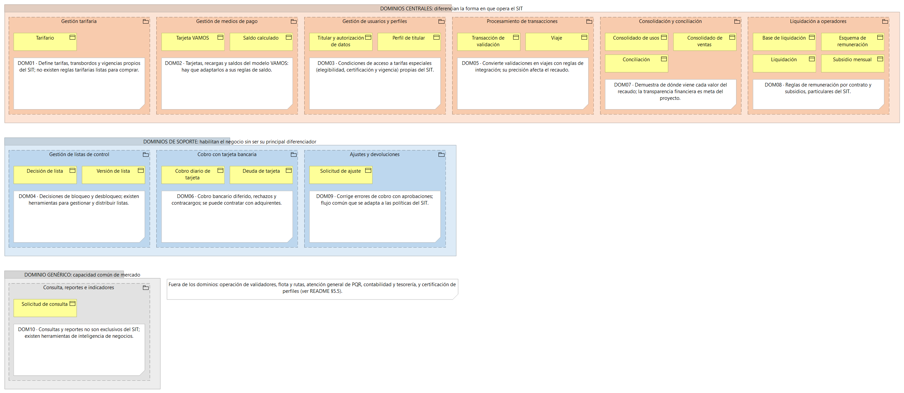

### 5.7. Clasificación de dominios

| Dominio | Clasificación | Argumento |
| ------- | ------------- | --------- |
| Gestión tarifaria | Central | **¿Qué diferencia al negocio?** Define las tarifas, los transbordos y las condiciones económicas particulares del SIT, que determinan cuánto paga cada usuario y cómo se integra el servicio. **¿Se puede comprar?** Existen herramientas de gestión tarifaria, pero no se pueden adquirir listas las reglas específicas del SIT: deben configurarse según sus políticas, modos de transporte y actos administrativos. |
| Gestión de medios de pago | Central | **¿Qué diferencia al negocio?** Gestiona las tarjetas, las recargas y los saldos dentro del modelo de recaudo del SIT, integrando sus medios de pago con las reglas tarifarias. **¿Se puede comprar?** Existen plataformas de medios de pago, pero deben adaptarse a las tarjetas VAMOS, sus reglas de saldo y las integraciones del sistema. |
| Gestión de usuarios y perfiles | Central | **¿Qué diferencia al negocio?** Administra las condiciones de acceso a tarifas especiales para estudiantes, adultos mayores y personas con discapacidad, de acuerdo con los requisitos y vigencias establecidos. **¿Se puede comprar?** Se pueden adquirir herramientas de gestión de usuarios, pero las condiciones de elegibilidad, certificación y aplicación de los beneficios deben configurarse para el SIT. |
| Gestión de listas de control | De soporte | **¿Qué diferencia al negocio?** Permite controlar el uso de tarjetas mediante decisiones de bloqueo y desbloqueo, pero no constituye por sí sola la principal fuente de diferenciación del SIT. **¿Se puede comprar?** Sí, existen mecanismos y herramientas para gestionar listas de control y distribuirlas; deben adaptarse a las interfaces del proveedor y a las necesidades operativas del sistema. |
| Procesamiento de transacciones | Central | **¿Qué diferencia al negocio?** Convierte las validaciones recibidas en viajes procesados, aplicando las reglas tarifarias y resolviendo situaciones como transacciones duplicadas, tardías o incompletas. La precisión de este proceso afecta el recaudo y los cálculos posteriores. **¿Se puede comprar?** Existen plataformas de procesamiento, pero deben adaptarse a las reglas de integración, los medios de pago y las condiciones operativas del SIT. |
| Cobro con tarjeta bancaria | De soporte | **¿Qué diferencia al negocio?** Permite aceptar pagos bancarios y gestionar rechazos, cartera y contracargos, ampliando las opciones de pago para los usuarios. La autorización y el procesamiento bancario no son capacidades exclusivas del SIT. **¿Se puede comprar?** Sí, se pueden contratar pasarelas, adquirentes y servicios de pago; es necesario integrarlos con las validaciones y la conciliación del recaudo. |
| Consolidación y conciliación | Central | **¿Qué diferencia al negocio?** Permite comprobar que el recaudo registrado coincida con las ventas, recargas y consignaciones, identificar diferencias y demostrar de dónde proviene cada valor. La transparencia financiera es una de las metas principales del proyecto. **¿Se puede comprar?** Existen herramientas de conciliación, pero las reglas de agrupación, las fuentes de información y los controles deben adaptarse al modelo financiero del SIT. |
| Liquidación a operadores | Central | **¿Qué diferencia al negocio?** Determina cuánto corresponde a cada operador según sus condiciones contractuales y calcula los subsidios correspondientes. Las reglas de remuneración y la distribución de recursos son particulares de los contratos y del sistema. **¿Se puede comprar?** Se pueden adquirir herramientas de cálculo y liquidación, pero las fórmulas contractuales, los parámetros y la trazabilidad deben configurarse para el SIT. |
| Ajustes y devoluciones | De soporte | **¿Qué diferencia al negocio?** Permite corregir errores de cobro y tramitar devoluciones con sus respectivas aprobaciones y evidencias. Es importante para la confianza del usuario, pero apoya los procesos principales de recaudo y conciliación. **¿Se puede comprar?** Sí, existen herramientas de gestión de solicitudes y flujos de aprobación que pueden adaptarse a las políticas y los controles del SIT. |
| Consulta, reportes e indicadores | Genérico | **¿Qué diferencia al negocio?** La consulta de información y la generación de reportes no son capacidades exclusivas del SIT; su valor reside en los datos y los indicadores específicos que necesita la organización. **¿Se puede comprar?** Sí, existen herramientas de inteligencia de negocios, generación de informes y visualización que pueden configurarse con los datos, las métricas y los permisos del sistema. |

#### Criterio aplicado

Un dominio es central cuando contiene reglas o capacidades que diferencian la forma en que opera el SIT; es de soporte cuando habilita o facilita el negocio sin constituir su principal diferenciador; y es genérico cuando ofrece capacidades comunes disponibles como productos o servicios existentes.

### 5.8. Glosario de lenguaje ubicuo

#### Objetivo

Establecer un lenguaje común entre el equipo de arquitectura, Recaudo y Tarifas y las demás áreas involucradas en el SIT. El glosario define los términos utilizados en el proceso de recaudo y en los dominios identificados en §5.4, evitando que una misma palabra se interprete de manera diferente según el contexto.

Cuando un término tiene más de un significado, se identifica explícitamente el contexto al que pertenece cada definición.

#### Glosario de términos

| Término | Definición | Dominio | Ejemplo |
|---|---|---|---|
| Viaje | Trayecto realizado por un pasajero, que puede comprender una o varias validaciones y transbordos. No equivale necesariamente a una única validación. | Procesamiento de transacciones | Un pasajero utiliza un bus alimentador y después el metro para completar su desplazamiento. |
| Validación | Registro generado cuando un medio de pago se presenta ante un validador. Puede ser aceptada o rechazada y no siempre implica un cobro efectivo. | Procesamiento de transacciones | Un pasajero presenta su tarjeta VAMOS y el validador registra el resultado de la operación. |
| Transbordo | Cambio de un servicio o modo de transporte a otro dentro de las condiciones de integración tarifaria establecidas. Puede tener un cobro adicional o beneficiarse de una tarifa integrada. | Gestión tarifaria | Un pasajero cambia de un bus alimentador al metro dentro de la ventana de integración permitida. |
| Tarifa | **Contexto 1 — Configuración tarifaria:** valor o regla definido en el tarifario vigente. **Contexto 2 — Aplicación al viaje:** valor que corresponde cobrar después de aplicar las reglas a una validación o secuencia de viaje. La tarifa configurada no necesariamente coincide con el importe efectivamente cobrado. | Gestión tarifaria / Procesamiento de transacciones | El tarifario establece una tarifa plena, pero una validación puede recibir una tarifa reducida por un transbordo válido. |
| Saldo | **Contexto 1 — Medio de pago:** valor disponible asociado a una tarjeta prepago. **Contexto 2 — Liquidación:** valor pendiente de pagar, recibir o ajustar entre las partes involucradas en la liquidación. Los dos significados no deben confundirse. | Gestión de medios de pago / Liquidación a operadores | Una tarjeta tiene saldo disponible para viajar, mientras que un operador tiene un saldo pendiente de liquidación. |
| Usuario | Persona que utiliza los servicios del SIT o interactúa con sus canales. El término por sí solo no determina si es quien viaja, quien posee la tarjeta o quien presenta una reclamación. | Gestión de usuarios y perfiles | Una persona consulta el saldo de su tarjeta VAMOS. |
| Pasajero | Persona que realiza un desplazamiento en alguno de los modos de transporte del SIT. | Procesamiento de transacciones | Un pasajero valida su tarjeta al ingresar al metro. |
| Titular | Persona registrada como titular de un medio de pago personalizado. No necesariamente debe coincidir con quien presenta una consulta o reclamación. | Gestión de medios de pago | Una tarjeta personalizada está registrada a nombre de una persona. |
| Cliente | Persona que establece una relación de atención o servicio con la organización. En este proyecto, el término debe precisarse según el proceso, porque puede referirse a un usuario que presenta una PQR y no necesariamente al titular de la tarjeta. | Ajustes y devoluciones | Una persona solicita la revisión de un cobro y se registra su caso de atención. |
| Perfil | **Contexto 1 — Perfil tarifario:** condición que determina si una persona puede acceder a un beneficio tarifario. **Contexto 2 — Perfil de usuario del sistema:** conjunto de permisos que determina qué información o funciones puede consultar una persona dentro del software. No son equivalentes. | Gestión de usuarios y perfiles / Infraestructura y seguridad | Un estudiante tiene un perfil tarifario especial; un analista tiene permisos para consultar liquidaciones. |
| Operador | **Contexto 1 — Operador de transporte:** empresa que presta el servicio de transporte y cuya remuneración se calcula según su contrato. **Contexto 2 — Operador de recaudo:** proveedor responsable de los dispositivos y servicios de recaudo contratados. El significado debe aclararse en cada conversación y registro. | Liquidación a operadores / Integración con el proveedor | El operador de transporte recibe una liquidación; el operador de recaudo entrega las transacciones registradas por los validadores. |
| Transacción | **Contexto 1 — Transacción de validación:** registro generado por un validador que contiene información del intento o uso del medio de pago. **Contexto 2 — Transacción financiera:** operación de pago o movimiento procesado por una red financiera. Una validación no equivale necesariamente a una transacción financiera aprobada. | Procesamiento de transacciones / Cobro con tarjeta bancaria | El proveedor envía un registro de validación y posteriormente la red financiera informa el resultado del cobro. |
| Tarjeta VAMOS | Medio de pago propio del escenario del SIT, disponible en modalidad personalizada o al portador, utilizado para acceder al servicio y gestionar saldo prepago. | Gestión de medios de pago | Un usuario recarga su tarjeta VAMOS antes de viajar. |
| Recarga | Operación mediante la cual se incorpora valor a un medio de pago prepago. Debe distinguirse del registro de la venta y de la confirmación financiera del ingreso. | Gestión de medios de pago | Un usuario realiza una recarga y el sistema registra la operación correspondiente. |
| Saldo calculado | Saldo que el sistema central determina a partir de las recargas, validaciones, ajustes y demás movimientos conocidos. Puede diferir temporalmente del saldo registrado en la tarjeta cuando existen transacciones pendientes de recepción. | Gestión de medios de pago | Una transacción todavía no recibida hace que el saldo reconstruido por el sistema central sea diferente del saldo registrado previamente. |
| Bloqueo | Decisión que impide o restringe el uso de un medio de pago, por ejemplo, por pérdida o por una condición de control. Su aplicación efectiva depende de la actualización de los sistemas que participan en la validación. | Gestión de listas de control | Una tarjeta reportada como perdida se bloquea y la decisión se distribuye a los validadores. |
| Lista de control | Conjunto de registros que comunica condiciones de bloqueo u otras decisiones que los dispositivos deben aplicar según las reglas operativas. | Gestión de listas de control | El proveedor recibe una lista actualizada para impedir el uso de tarjetas bloqueadas. |
| Transacción duplicada | Registro recibido más de una vez que corresponde a una misma operación de origen y debe identificarse para evitar contabilizaciones o cobros repetidos. | Procesamiento de transacciones | Un lote se transmite nuevamente y el sistema identifica registros que ya habían sido procesados. |
| Conciliación | Proceso de comparar registros de diferentes fuentes para identificar coincidencias, diferencias y valores pendientes de explicación. | Consolidación y conciliación | Se comparan las ventas registradas con las consignaciones recibidas y se investiga una diferencia. |
| Diferencia de conciliación | Desviación identificada entre los valores o registros que deberían coincidir según las reglas de conciliación. Debe investigarse y documentarse antes de considerarse resuelta. | Consolidación y conciliación | El valor reportado por el proveedor no coincide con el valor consignado a la fiducia. |
| Consolidado de usos | Validaciones e importes agrupados por modo, ruta, operador y periodo. Es el insumo de la conciliación y de la base de liquidación. | Consolidación y conciliación | El consolidado de la semana muestra cuánto se recaudó en la ruta alimentadora A12 por operador. |
| Consolidado de ventas | Ventas y recargas agrupadas por canal y periodo. Se compara con las consignaciones en la conciliación. | Consolidación y conciliación | Las recargas de las taquillas del metro suman un valor que se contrasta con lo consignado en la fiducia. |
| Liquidación | Proceso de determinar los valores que corresponden a cada operador, aplicando las reglas contractuales y la información operativa y financiera pertinente. | Liquidación a operadores | Se calcula el valor que corresponde pagar a un operador por un periodo. |
| Base de liquidación | Conjunto de datos y parámetros utilizados para calcular la remuneración de los operadores y los valores relacionados. | Liquidación a operadores | La base reúne el recaudo consolidado y los datos operativos necesarios para aplicar la fórmula contractual. |
| Esquema de remuneración | Reglas contractuales que determinan cómo se calcula el pago correspondiente a un operador. | Liquidación a operadores | La liquidación aplica la fórmula establecida en el contrato del operador. |
| Subsidio | Recurso destinado a cubrir el beneficio tarifario o la diferencia económica que corresponda según las reglas aplicables y la entidad responsable de financiarlo. | Liquidación a operadores | El sistema calcula el valor de los subsidios que debe solicitarse a la Alcaldía. |
| Deuda de tarjeta | Valor que debe una tarjeta débito o crédito cuando el cobro de sus viajes es rechazado. Mientras no se pague, la tarjeta queda en lista de denegación. | Cobro con tarjeta bancaria | El cobro diario de un visitante es rechazado tres veces y queda una deuda de tarjeta por el valor de sus viajes. |
| Cartera | Total de las deudas de tarjeta pendientes de cobro o recuperación, como lo ve Finanzas. Para una sola tarjeta se dice «deuda de tarjeta». | Cobro con tarjeta bancaria | Finanzas revisa la cartera bancaria del mes para medir las pérdidas por cobros rechazados. |
| Contracargo | Reversión o disputa de una operación de pago iniciada a través del mecanismo financiero correspondiente. Requiere seguimiento y conciliación con los actores financieros. | Cobro con tarjeta bancaria | Una operación bancaria es disputada y se registra para su revisión. |
| Ajuste | Modificación autorizada de un registro o valor económico para corregir una diferencia o un error documentado. Debe conservarse su motivo y trazabilidad. | Ajustes y devoluciones | Se registra un ajuste después de confirmar que un usuario recibió un cobro incorrecto. |
| Devolución | Operación mediante la cual se retorna un valor al usuario después de la revisión y aprobación correspondientes. | Ajustes y devoluciones | Se aprueba devolver un cobro duplicado identificado durante una reclamación. |
| Solicitud de consulta | Pedido de información del recaudo que hace un usuario autorizado, con sus filtros y periodo. | Consulta, reportes e indicadores | Un analista de Finanzas pide el recaudo de un operador en el mes anterior. |

#### Vocabulario del equipo (DDD y SOA)

Estos términos los usa el equipo de arquitectura para describir el diseño; no son lenguaje del negocio y por eso no aparecen en V7.

| Término | Definición | Ámbito | Ejemplo |
|---|---|---|---|
| Evento de negocio | Hecho relevante que ocurre en el negocio y que puede desencadenar actividades posteriores. Se expresa como algo que sucedió, no como una orden para ejecutar una acción. | Transversal a los dominios | Se detectó una diferencia de conciliación. |
| Comando | Solicitud que expresa la intención de ejecutar una acción de negocio. Generalmente se formula como una acción en imperativo. | Transversal a los dominios | `RecargarTarjeta` solicita registrar una recarga. |
| Entidad | Objeto del dominio que posee identidad propia y cuyo estado puede cambiar a lo largo del tiempo. | Transversal a los dominios | Una tarjeta conserva su identidad aunque cambien su saldo o su estado de bloqueo. |
| Objeto de valor | Objeto definido por sus atributos y no por una identidad independiente; sus valores se tratan como inmutables. | Transversal a los dominios | `Dinero` representa un importe y una moneda determinados. |
| Agregado | Conjunto de objetos de dominio que mantiene un límite de consistencia y protege reglas que deben cumplirse en sus operaciones. | Transversal a los dominios | Un agregado de tarjeta puede proteger la regla de que una tarjeta bloqueada no valide. |
| Invariante | Regla que debe mantenerse verdadera dentro del límite de consistencia de un agregado. | Transversal a los dominios | El saldo no puede quedar por debajo del límite permitido por las reglas del medio de pago. |
| Política de negocio | Regla que coordina actividades o reacciones entre procesos, servicios o eventos y que no necesariamente se resuelve dentro de un único agregado. | Transversal a los dominios | Cuando se aprueba un ajuste, una política determina qué proceso debe recibir la novedad para actualizar la conciliación. |
| Contrato de servicio | Definición explícita de lo que un servicio recibe, devuelve, los errores que comunica y sus requisitos no funcionales. | Transversal a los servicios | El contrato de recepción de transacciones define el formato de entrada y la respuesta ante registros inválidos. |
| Capa anticorrupción (ACL) | Mecanismo de integración que transforma o adapta los conceptos de un sistema externo para preservar el lenguaje y las reglas del dominio interno. | Integración con sistemas externos | Una ACL traduce el formato de transacciones del proveedor al modelo utilizado por el procesamiento del SIT. |

#### Resolución explícita de términos ambiguos

Los términos siguientes requieren especial cuidado al hablar, documentar requisitos o definir contratos de servicios.

| Término ambiguo | Significados que deben distinguirse | Regla de uso |
|---|---|---|
| Viaje / Validación / Transbordo | El viaje representa el trayecto; la validación representa un registro de uso del medio de pago; el transbordo representa el cambio entre servicios o modos bajo condiciones tarifarias. | No utilizar «viaje» como sinónimo de una única validación. |
| Tarifa | Tarifa configurada en el tarifario frente a tarifa aplicada a una validación o viaje. | Especificar si se habla del valor configurado, calculado o efectivamente cobrado. |
| Saldo | Saldo disponible en un medio de pago frente a valor pendiente en una liquidación financiera. | Usar «saldo de tarjeta» o «saldo pendiente de liquidación», según corresponda. |
| Usuario / Pasajero / Titular / Cliente | Usuario del sistema; persona que viaja; titular registrado de una tarjeta; persona que interactúa con la atención al cliente. | Identificar el rol específico de la persona en cada proceso. No asumir que todos corresponden a la misma persona. |
| Perfil | Perfil tarifario que habilita beneficios frente a perfil de acceso al software que determina permisos. | Utilizar «perfil tarifario» o «perfil de acceso» de forma explícita. |
| Operador | Empresa operadora del transporte frente al proveedor operador del recaudo. | Especificar «operador de transporte» u «operador de recaudo». |
| Transacción | Registro de validación recibido del proveedor frente a operación financiera de pago. | Especificar «transacción de validación» o «transacción financiera» y no asumir que ambas se producen o aprueban simultáneamente. |
| Deuda de tarjeta / Cartera | La deuda de una tarjeta bancaria puntual frente al total de deudas pendientes que maneja Finanzas. | Usar «deuda de tarjeta» para una tarjeta y «cartera» para el total. |

#### Regla general de uso del lenguaje ubicuo

En los requisitos, contratos de servicios, eventos, comandos y documentación de los dominios se deben utilizar los términos definidos en este glosario. Cuando un término tenga más de un significado, se debe indicar el contexto o emplear la expresión específica establecida en la resolución de términos ambiguos. Las áreas de negocio y el equipo de arquitectura deben mantener estas definiciones consistentes en los modelos, las interfaces y las conversaciones del proyecto.

### V7 Lenguaje ubicuo
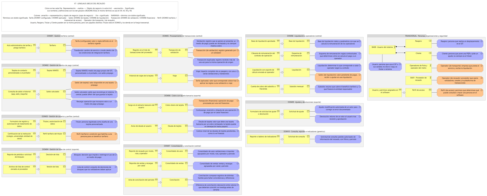

**Análisis.** La vista pasa el glosario al modelo. Cada fila se lee de izquierda a derecha: la *representación* (la forma concreta en que el término aparece en el negocio, como el acto de tarifas, el lote del proveedor o el acta de conciliación) realiza el *objeto de negocio*, y el *significado* asociado tiene la definición del glosario. Los objetos de negocio son los mismos 20 de V4d y V5, ordenados por dominio (DOM01 a DOM10), así que el término que se usa aquí es el mismo de las demás vistas. En total hay 37 significados y 21 representaciones. Los cinco términos que cambian de significado van en naranja y aparecen dos veces, una en cada contexto: «Tarifa» es la configurada en el tarifario (DOM01) o la aplicada a un viaje (DOM05); «Saldo» es el de la tarjeta (DOM02) o el pendiente de una liquidación (DOM08); «Transacción» es la de validación (DOM05) o la financiera (DOM06); «Perfil» es el tarifario (DOM03) o el de acceso al software, y «Operador» es el de transporte o el de recaudo. Así se ve en un solo diagrama que la misma palabra cae en objetos distintos según el contexto.

**Decisiones.** Las personas (usuario, pasajero y cliente) no son objetos de negocio sino papeles, así que van como actor y roles en una franja transversal: el actor «Usuario del sistema» se asigna a los roles «Pasajero» y «Cliente», y el titular sí es objeto de negocio porque el ente guarda su registro (DOM03). Los dos sentidos de «Operador» se asocian a los actores que ya existían (los operadores de flota y el proveedor de recaudo). Para el perfil de acceso se creó el objeto «Perfil de acceso», porque sin él no se podía mostrar la ambigüedad con el perfil tarifario. Los términos de DDD y SOA (entidad, agregado, comando, evento, etc.) no se dibujan: son vocabulario del equipo, no del negocio, y por eso el glosario los separa en su propia tabla. «Deuda de tarjeta» y «Cartera» se asocian al mismo objeto de negocio porque son dos niveles del mismo concepto: la deuda de una tarjeta y el total que ve Finanzas. Se agregaron al glosario «Consolidado de usos», «Consolidado de ventas» y «Solicitud de consulta», que ya eran objetos de negocio en V4d y V5 pero no estaban definidos.

## 6. Agregados, comandos y eventos
### V6 Agregados, comandos y eventos
_Un diagrama por dominio._

#### V6a _Dominio…_

### 6.1. Criterios de diseño

El diseño táctico utiliza agregados para agrupar los objetos que deben mantener sus reglas de negocio de forma consistente. Cada agregado tiene una raíz que controla las modificaciones de su estado y protege sus invariantes.

- **Entidad:** objeto con identidad propia y un ciclo de vida.
- **Objeto de valor:** objeto definido por sus atributos, sin identidad independiente.
- **Agregado:** límite de consistencia que agrupa una raíz y los objetos que esta controla.
- **Invariante:** regla que debe cumplirse antes y después de cada operación confirmada.
- **Comando:** solicitud para ejecutar una acción.
- **Evento:** hecho ocurrido como resultado de una operación aceptada.

Cada tabla presenta un agregado representativo por dominio. Los sistemas externos, como los validadores, las redes financieras y la fiduciaria, se tratan como fuentes o consumidores de información, no como agregados internos del SIT.

### 6.2. DOM01 — Gestión tarifaria

**Clasificación (§5.7):** Central.

Este dominio concentra las reglas tarifarias que diferencian la operación del SIT. El agregado `ConfiguraciónTarifaria` controla las versiones de las reglas y sus periodos de vigencia. Las tarifas aplicadas a un viaje se calculan en el dominio de Procesamiento de transacciones; no se confunden con los valores configurados aquí.

| Agregado (raíz)        | Entidades / objetos de valor                                                                                                                                                                                                                             | Invariantes                                                                                                                                                                                                                                                                          | Comandos                                                     | Eventos                                                        |
| ---------------------- | -------------------------------------------------------------------------------------------------------------------------------------------------------------------------------------------------------------------------------------------------------- | ------------------------------------------------------------------------------------------------------------------------------------------------------------------------------------------------------------------------------------------------------------------------------------ | ------------------------------------------------------------ | -------------------------------------------------------------- |
| ConfiguraciónTarifaria | **Entidad:** VersiónTarifaria, identificada por su versión. **Objetos de valor:** ValorTarifario, PeriodoVigencia, ReglaTransbordo, IdentificadorDeModo. Se incluyen porque definen las condiciones económicas y de aplicación de una versión tarifaria. | 1. Toda versión publicada debe contener valores tarifarios y reglas válidos. 2. El periodo de vigencia debe ser coherente y no puede tener una fecha final anterior a la inicial. 3. Una misma configuración no puede tener reglas contradictorias para el mismo contexto y periodo. | CrearConfiguraciónTarifaria; PublicarConfiguraciónTarifaria. | ConfiguraciónTarifariaCreada; ConfiguraciónTarifariaPublicada. |

**Alcance:** el agregado controla la configuración y publicación de las reglas tarifarias. No calcula por sí mismo el cobro de cada viaje ni realiza la liquidación a los operadores.

### 6.3. DOM02 — Gestión de medios de pago

**Clasificación (§5.7):** Central.

Este dominio administra el ciclo de vida de la tarjeta VAMOS y su saldo. La tarjeta es la raíz del agregado porque controla su estado y las operaciones que afectan directamente su saldo.

| Agregado (raíz) | Entidades / objetos de valor                                                                                                                                                                                                                                    | Invariantes                                                                                                                                                                                                                                                  | Comandos                           | Eventos                              |
| --------------- | --------------------------------------------------------------------------------------------------------------------------------------------------------------------------------------------------------------------------------------------------------------- | ------------------------------------------------------------------------------------------------------------------------------------------------------------------------------------------------------------------------------------------------------------ | ---------------------------------- | ------------------------------------ |
| TarjetaVAMOS    | **Entidad:** Tarjeta, identificada por un identificador único. **Objetos de valor:** IdentificadorTarjeta, SaldoCalculado, EstadoTarjeta, MontoRecarga. Se incluyen porque identifican la tarjeta, representan su saldo y describen las operaciones monetarias. | 1. Cada tarjeta debe tener un identificador único. 2. Una tarjeta bloqueada no puede autorizar nuevas operaciones de pago que requieran una tarjeta activa. 3. Una recarga confirmada debe reflejarse una sola vez en el saldo, evitando duplicar su efecto. | RegistrarRecarga; BloquearTarjeta. | RecargaRegistrada; TarjetaBloqueada. |

**Alcance:** el agregado administra el estado y saldo de una tarjeta. La recepción de eventos del validador y el procesamiento de los viajes corresponden al dominio de Procesamiento de transacciones.

### 6.4. DOM03 — Gestión de usuarios y perfiles

**Clasificación (§5.7):** Central.

Este dominio diferencia a la persona que utiliza el sistema, al titular de una tarjeta y al perfil que determina condiciones tarifarias. El agregado `AsignaciónPerfilTarifario` controla la asignación de un perfil a un titular; los datos personales y las evidencias de elegibilidad se mantienen dentro de los límites autorizados del dominio.

| Agregado (raíz)           | Entidades / objetos de valor                                                                                                                                                                                                                             | Invariantes                                                                                                                                                                                                                                                                                                                         | Comandos                                        | Eventos                                           |
| ------------------------- | -------------------------------------------------------------------------------------------------------------------------------------------------------------------------------------------------------------------------------------------------------- | ----------------------------------------------------------------------------------------------------------------------------------------------------------------------------------------------------------------------------------------------------------------------------------------------------------------------------------- | ----------------------------------------------- | ------------------------------------------------- |
| AsignaciónPerfilTarifario | **Entidades:** Titular, AsignaciónPerfil. **Objetos de valor:** IdentificadorTitular, TipoPerfilTarifario, PeriodoVigencia, EstadoElegibilidad. Se incluyen porque el titular posee identidad propia y la asignación tiene un ciclo de vida verificable. | 1. Una asignación debe referenciar un titular y un perfil tarifario identificables. 2. Un perfil solo puede aplicarse durante su periodo de vigencia y mientras cumpla las condiciones de elegibilidad establecidas. 3. La misma solicitud no puede producir dos asignaciones activas equivalentes para el mismo titular y periodo. | AsignarPerfilTarifario; RevocarPerfilTarifario. | PerfilTarifarioAsignado; PerfilTarifarioRevocado. |

**Alcance:** el agregado controla la asignación del perfil tarifario. La certificación oficial de la condición de cada persona pertenece a una entidad externa; el SIT registra y utiliza el resultado recibido. Los perfiles de acceso al sistema son distintos de los perfiles tarifarios.

### 6.5. DOM04 — Gestión de listas de control

**Clasificación (§5.7):** De soporte.

Este dominio gestiona las decisiones de inclusión y exclusión de tarjetas en listas de control. La raíz representa la entrada de control de una tarjeta, mientras que las listas y sus versiones determinan cómo se distribuyen las decisiones hacia los componentes que las consumen.

| Agregado (raíz)     | Entidades / objetos de valor                                                                                                                                                                                                                                                             | Invariantes                                                                                                                                                                                                                                                                                                       | Comandos                                        | Eventos                                           |
| ------------------- | ---------------------------------------------------------------------------------------------------------------------------------------------------------------------------------------------------------------------------------------------------------------------------------------- | ----------------------------------------------------------------------------------------------------------------------------------------------------------------------------------------------------------------------------------------------------------------------------------------------------------------- | ----------------------------------------------- | ------------------------------------------------- |
| EntradaListaControl | **Entidad:** EntradaControl, identificada por la tarjeta y su registro de control. **Objetos de valor:** IdentificadorTarjeta, TipoDecisión, MotivoControl, PeriodoVigencia, VersiónLista. Se incluyen porque expresan la decisión, su justificación y la versión que debe distribuirse. | 1. Cada entrada debe identificar la tarjeta y la decisión de control correspondiente. 2. Una decisión publicada debe tener una versión identificable y no puede distribuirse como si fuera una versión anterior. 3. Una entrada revocada no debe seguir figurando como una decisión vigente en la versión actual. | RegistrarDecisiónControl; PublicarVersiónLista. | DecisiónControlRegistrada; VersiónListaPublicada. |

**Alcance:** el agregado conserva las decisiones de control y su publicación lógica. La operación de validadores y lectores queda fuera del alcance interno; estos consumen las listas a través de las interfaces correspondientes.

### 6.6. DOM05 — Procesamiento de transacciones

**Clasificación (§5.7):** Central.

Este dominio recibe registros de validación y los transforma en transacciones procesadas, aplicando reglas tarifarias, perfiles y transbordos. La raíz `TransacciónDeViaje` mantiene el ciclo de procesamiento de un registro sin confundirlo con una transacción financiera de una red bancaria.

| Agregado (raíz)    | Entidades / objetos de valor                                                                                                                                                                                                                                                                                                                                                   | Invariantes                                                                                                                                                                                                                                                                                                                                                             | Comandos                                                 | Eventos                                                    |
| ------------------ | ------------------------------------------------------------------------------------------------------------------------------------------------------------------------------------------------------------------------------------------------------------------------------------------------------------------------------------------------------------------------------ | ----------------------------------------------------------------------------------------------------------------------------------------------------------------------------------------------------------------------------------------------------------------------------------------------------------------------------------------------------------------------- | -------------------------------------------------------- | ---------------------------------------------------------- |
| TransacciónDeViaje | **Entidad:** TransacciónDeViaje, identificada por el registro de origen y su identidad de procesamiento. **Objetos de valor:** IdentificadorEventoOrigen, FechaHoraValidación, IdentificadorTarjeta, ContextoTarifario, ImporteAplicado, EstadoProcesamiento. Se incluyen porque permiten identificar el registro, reconstruir su contexto y conservar el resultado calculado. | 1. Un mismo evento de origen no puede procesarse más de una vez como una transacción válida; los reintentos deben ser idempotentes. 2. Una transacción procesada debe conservar referencias al evento de origen y a las reglas utilizadas. 3. El importe aplicado debe corresponder a las reglas tarifarias y al perfil vigentes en el contexto definido para el viaje. | ProcesarRegistroValidación; ReprocesarTransacciónTardía. | TransacciónDeViajeProcesada; TransacciónTardíaReprocesada. |

**Alcance:** el agregado procesa cada registro y conserva su resultado. La reconstrucción de un viaje completo, con varias validaciones y transbordos, debe coordinar los registros relacionados; no se asume que cada validación sea por sí sola un viaje completo. La entrada original proviene de proveedores externos.

### 6.7. DOM06 — Cobro con tarjeta bancaria

**Clasificación (§5.7):** De soporte.

Este dominio administra el cobro bancario diferido y el seguimiento de respuestas, rechazos y contracargos. Se diferencia de la tarjeta VAMOS: aquí la operación financiera depende de una red o entidad financiera externa.

| Agregado (raíz) | Entidades / objetos de valor                                                                                                                                                                                                                                                                              | Invariantes                                                                                                                                                                                                                                                                                                                    | Comandos                                           | Eventos                                              |
| --------------- | --------------------------------------------------------------------------------------------------------------------------------------------------------------------------------------------------------------------------------------------------------------------------------------------------------- | ------------------------------------------------------------------------------------------------------------------------------------------------------------------------------------------------------------------------------------------------------------------------------------------------------------------------------ | -------------------------------------------------- | ---------------------------------------------------- |
| CobroBancario   | **Entidad:** CobroBancario, identificado por una referencia única de cobro. **Objetos de valor:** ReferenciaFinanciera, MontoCobro, EstadoCobro, CódigoRespuesta, ReferenciaExterna. Se incluyen para mantener la identidad de la operación, el valor solicitado y la respuesta del proveedor financiero. | 1. Cada solicitud de cobro debe tener una referencia única para evitar cobros duplicados por reintentos. 2. El importe del cobro debe ser positivo y corresponder al importe autorizado para la operación. 3. Un cobro confirmado no puede cambiar directamente a un estado incompatible sin una operación posterior trazable. | SolicitarCobroBancario; RegistrarRespuestaDeCobro. | CobroBancarioSolicitado; RespuestaDeCobroRegistrada. |

**Alcance:** el agregado registra la solicitud y la respuesta del cobro. La autorización, el movimiento de fondos y la decisión final de la red financiera son responsabilidad del proveedor externo. Los contracargos pueden requerir un proceso adicional de gestión y resolución.

### 6.8. DOM07 — Consolidación y conciliación

**Clasificación (§5.7):** Central.

Este dominio agrupa importes y contrasta los registros del recaudo con las ventas, recargas y consignaciones reportadas por las fuentes involucradas. La raíz `ProcesoConciliación` controla una ejecución concreta y sus resultados, evitando mezclar diferentes periodos o fuentes.

| Agregado (raíz)     | Entidades / objetos de valor                                                                                                                                                                                                                                                                                         | Invariantes                                                                                                                                                                                                                                                                                                                          | Comandos                                              | Eventos                                                 |
| ------------------- | -------------------------------------------------------------------------------------------------------------------------------------------------------------------------------------------------------------------------------------------------------------------------------------------------------------------- | ------------------------------------------------------------------------------------------------------------------------------------------------------------------------------------------------------------------------------------------------------------------------------------------------------------------------------------ | ----------------------------------------------------- | ------------------------------------------------------- |
| ProcesoConciliación | **Entidad:** ProcesoConciliación, identificado por su ejecución y periodo. **Objetos de valor:** PeriodoRecaudo, FuenteFinanciera, ImporteReportado, ImporteCalculado, DiferenciaConciliación, EstadoConciliación. Se incluyen porque delimitan el periodo, las fuentes comparadas y el resultado de la comparación. | 1. Una conciliación debe identificar el periodo y las fuentes de información comparadas. 2. El resultado debe conservar los importes comparados y permitir determinar la diferencia entre ellos. 3. Una conciliación no puede declararse conforme mientras existan diferencias pendientes de resolución según las reglas aplicables. | EjecutarConciliación; RegistrarResultadoConciliación. | ConciliaciónEjecutada; ResultadoConciliaciónRegistrado. |

**Alcance:** el agregado controla una ejecución de conciliación y su resultado. La consolidación previa de los registros puede alimentar el proceso; la liquidación utiliza los resultados validados como insumo, pero mantiene su propio agregado.

### 6.9. DOM08 — Liquidación a operadores

**Clasificación (§5.7):** Central.

Este dominio determina los importes que corresponden a los operadores a partir de una base de liquidación y un esquema de remuneración. El agregado `LiquidaciónOperador` mantiene el cálculo y su estado de aprobación; la transferencia de fondos es una operación externa.

| Agregado (raíz)     | Entidades / objetos de valor                                                                                                                                                                                                                                                                                                                        | Invariantes                                                                                                                                                                                                                                                                                                                                                                   | Comandos                                 | Eventos                                    |
| ------------------- | --------------------------------------------------------------------------------------------------------------------------------------------------------------------------------------------------------------------------------------------------------------------------------------------------------------------------------------------------- | ----------------------------------------------------------------------------------------------------------------------------------------------------------------------------------------------------------------------------------------------------------------------------------------------------------------------------------------------------------------------------- | ---------------------------------------- | ------------------------------------------ |
| LiquidaciónOperador | **Entidad:** LiquidaciónOperador, identificada por operador y periodo de liquidación. **Objetos de valor:** IdentificadorOperador, PeriodoLiquidación, BaseLiquidación, EsquemaRemuneración, ImporteLiquidación, ImporteSubsidio, EstadoLiquidación. Se incluyen para establecer el destinatario, el periodo, las reglas y los importes calculados. | 1. Toda liquidación debe estar asociada a un operador, un periodo y una base de cálculo identificables. 2. Los importes deben calcularse con un esquema de remuneración aplicable al periodo correspondiente. 3. Una liquidación aprobada no puede modificarse silenciosamente; cualquier corrección debe quedar registrada mediante un ajuste o un nuevo proceso autorizado. | CalcularLiquidación; AprobarLiquidación. | LiquidaciónCalculada; LiquidaciónAprobada. |

**Alcance:** el agregado calcula y controla el estado de la liquidación de cada operador. La aprobación habilita la instrucción de pago, pero la ejecución de la transferencia y su confirmación corresponden a la fiduciaria o al sistema financiero externo.

### 6.10. DOM09 — Ajustes y devoluciones

**Clasificación (§5.7):** De soporte.

Este dominio gestiona solicitudes de corrección o devolución relacionadas con operaciones del recaudo. El agregado `SolicitudAjuste` controla el ciclo de vida de cada solicitud y mantiene trazabilidad de la decisión tomada.

| Agregado (raíz) | Entidades / objetos de valor                                                                                                                                                                                                                                                                      | Invariantes                                                                                                                                                                                                                                                                                                                                                             | Comandos                                           | Eventos                                             |
| --------------- | ------------------------------------------------------------------------------------------------------------------------------------------------------------------------------------------------------------------------------------------------------------------------------------------------- | ----------------------------------------------------------------------------------------------------------------------------------------------------------------------------------------------------------------------------------------------------------------------------------------------------------------------------------------------------------------------- | -------------------------------------------------- | --------------------------------------------------- |
| SolicitudAjuste | **Entidad:** SolicitudAjuste, identificada por un número único. **Objetos de valor:** TipoSolicitud, ReferenciaOperación, ImporteSolicitado, MotivoSolicitud, EstadoSolicitud, DecisiónResolución. Se incluyen porque describen la operación afectada, el motivo y el resultado de la evaluación. | 1. Toda solicitud debe tener identificador, motivo y referencia a la operación que origina el caso, cuando aplique. 2. El importe solicitado debe ser válido y no puede superar el importe elegible de la operación de origen. 3. Una solicitud resuelta no puede aprobarse o rechazarse nuevamente como si siguiera pendiente; una nueva revisión debe quedar trazada. | RegistrarSolicitudAjuste; ResolverSolicitudAjuste. | SolicitudAjusteRegistrada; SolicitudAjusteResuelta. |

**Alcance:** el agregado registra, evalúa y resuelve la solicitud. La ejecución contable o financiera de una devolución debe integrarse con los dominios o sistemas responsables, sin asumir que la aprobación equivale a un reembolso ya pagado.

### 6.11. DOM10 — Consulta, reportes e indicadores

**Clasificación (§5.7):** Genérico.

Este dominio expone información de consulta y resultados agregados para los usuarios autorizados. Dado que su función principal es presentar información y no ser la fuente maestra de las transacciones, utiliza un modelo de consulta separado de los agregados operacionales.

| Agregado (raíz)   | Entidades / objetos de valor                                                                                                                                                                                                                                                                                                | Invariantes                                                                                                                                                                                                                                                                                                                                  | Comandos                                     | Eventos                                        |
| ----------------- | --------------------------------------------------------------------------------------------------------------------------------------------------------------------------------------------------------------------------------------------------------------------------------------------------------------------------- | -------------------------------------------------------------------------------------------------------------------------------------------------------------------------------------------------------------------------------------------------------------------------------------------------------------------------------------------- | -------------------------------------------- | ---------------------------------------------- |
| SolicitudConsulta | **Entidad:** SolicitudConsulta, identificada por una referencia única. **Objetos de valor:** IdentificadorSolicitante, TipoConsulta, FiltrosConsulta, PeriodoConsulta, EstadoConsulta, ResultadoConsulta. Se incluyen para definir quién solicita la información, qué criterios utiliza y cuál es el estado de la consulta. | 1. Toda consulta debe identificar el tipo de información solicitada y los filtros necesarios. 2. La información solo puede entregarse si el solicitante está autorizado para acceder a ella. 3. El resultado debe corresponder a los filtros y al periodo solicitados, indicando cuando la información no esté disponible o esté incompleta. | SolicitarConsulta; GenerarResultadoConsulta. | ConsultaSolicitada; ResultadoConsultaGenerado. |

**Alcance:** el agregado controla la solicitud y la generación del resultado. Los reportes e indicadores consumen datos de los dominios operacionales; no modifican directamente las tarjetas, las transacciones, las conciliaciones ni las liquidaciones.

### 6.12. Límites de consistencia e interacción entre dominios

Los agregados definidos mantienen la consistencia de sus propias reglas y no deben modificarse directamente desde otro dominio. La comunicación entre dominios se realiza mediante comandos, contratos de servicio y eventos de negocio, según corresponda.

| Interacción                                                     | Información intercambiada                                            | Límite de responsabilidad                                                                                             |
| --------------------------------------------------------------- | -------------------------------------------------------------------- | --------------------------------------------------------------------------------------------------------------------- |
| Gestión tarifaria → Procesamiento de transacciones              | Reglas y versión tarifaria aplicable.                                | Tarifas configura y publica; Procesamiento aplica las reglas al registro del viaje.                                   |
| Gestión de usuarios y perfiles → Procesamiento de transacciones | Perfil tarifario y vigencia.                                         | Gestión de perfiles administra asignaciones; Procesamiento determina su aplicación en cada operación.                 |
| Gestión de medios de pago → Procesamiento de transacciones      | Estado de tarjeta y saldo pertinente.                                | Medios de pago administra tarjeta y saldo; Procesamiento registra el resultado del viaje.                             |
| Procesamiento de transacciones → Consolidación y conciliación   | Transacciones procesadas e importes calculados.                      | Procesamiento genera registros; Consolidación agrupa y Conciliación compara fuentes.                                  |
| Consolidación y conciliación → Liquidación a operadores         | Base de liquidación y resultado de conciliación.                     | Conciliación determina diferencias; Liquidación calcula importes para los operadores.                                 |
| Cobro con tarjeta bancaria → Consolidación y conciliación       | Solicitudes, respuestas e importes reportados por redes financieras. | Cobro registra las operaciones; Conciliación contrasta los datos financieros recibidos.                               |
| Ajustes y devoluciones → Dominios involucrados                  | Decisión de ajuste o devolución y referencia de la operación.        | Ajustes resuelve solicitudes; el dominio responsable registra la modificación operativa o financiera correspondiente. |
| Dominios operacionales → Consulta, reportes e indicadores       | Datos y eventos necesarios para consultas y métricas.                | Los dominios operacionales conservan la fuente de verdad; Consulta presenta información autorizada.                   |

## 7. Mapa de contextos e interoperabilidad
### V8 Mapa de contextos
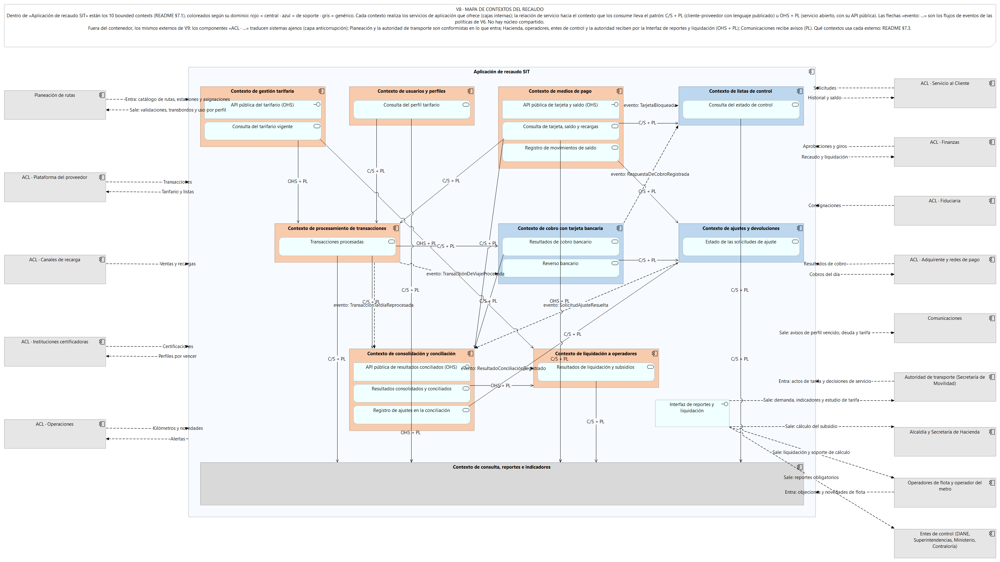

### 7.1. Bounded contexts identificados

| Código | Bounded context | Responsabilidad |
| ------ | --------------- | --------------- |
| BC01 | Gestión tarifaria | Configurar, versionar, publicar y consultar las reglas tarifarias. |
| BC02 | Gestión de medios de pago | Administrar tarjetas VAMOS, recargas, estados y saldos calculados. |
| BC03 | Gestión de usuarios y perfiles | Gestionar titulares, datos personales, elegibilidad y perfiles tarifarios. |
| BC04 | Gestión de listas de control | Registrar decisiones de bloqueo o denegación y publicar versiones de listas. |
| BC05 | Procesamiento de transacciones | Recibir validaciones, reconstruir viajes, reconocer transbordos y determinar tarifas esperadas. |
| BC06 | Cobro con tarjeta bancaria | Gestionar cobros diferidos, respuestas, deudas y contracargos. |
| BC07 | Consolidación y conciliación | Consolidar usos y ventas, comparar fuentes y gestionar diferencias. |
| BC08 | Liquidación a operadores | Calcular y aprobar liquidaciones y subsidios según las reglas y contratos vigentes. |
| BC09 | Ajustes y devoluciones | Registrar y tramitar solicitudes de ajuste, devolución, reverso o traslado de saldo. |
| BC10 | Consulta, reportes e indicadores | Consultar historiales, generar indicadores, detectar anomalías y producir reportes. |

### 7.2. Relaciones entre bounded contexts internos

| Contexto A | Contexto B | Patrón | Justificación |
| ---------- | ---------- | ------ | ------------- |
| BC05 Procesamiento de transacciones | BC01 Gestión tarifaria | C/S + PL | Procesamiento consulta las reglas y la versión tarifaria aplicable a la fecha de validación. Gestión tarifaria conserva la autoridad sobre las reglas publicadas. |
| BC05 Procesamiento de transacciones | BC02 Gestión de medios de pago | C/S + PL | Procesamiento necesita identificar el medio de pago y consultar el estado o saldo pertinente. Medios de pago administra el ciclo de vida de la tarjeta. |
| BC05 Procesamiento de transacciones | BC03 Gestión de usuarios y perfiles | C/S + PL | Procesamiento consulta el perfil tarifario y su vigencia para determinar la tarifa esperada. Gestión de perfiles conserva las reglas de elegibilidad y asignación. |
| BC04 Gestión de listas de control | BC02 Gestión de medios de pago | C/S + PL | Las decisiones de control identifican tarjetas, mientras que el ciclo de vida y el saldo pertenecen a Medios de pago. El bloqueo de una tarjeta no equivale a registrar una decisión de lista. |
| BC06 Cobro con tarjeta bancaria | BC05 Procesamiento de transacciones | C/S + PL | El cobro diferido necesita los viajes cerrados y sus importes. Procesamiento conserva los registros del viaje y el cálculo de la tarifa esperada. |
| BC07 Consolidación y conciliación | BC05 Procesamiento de transacciones | C/S + PL | Consolidación consume las transacciones procesadas para agrupar los usos por periodo, modo, ruta y operador. |
| BC07 Consolidación y conciliación | BC06 Cobro con tarjeta bancaria | C/S + PL | Conciliación necesita los resultados de cobros, rechazos y abonos para contrastarlos con los registros del recaudo. |
| BC07 Consolidación y conciliación | BC02 Gestión de medios de pago | C/S + PL | La conciliación de ventas y recargas requiere información de recargas y movimientos, sin asumir que el saldo calculado sea idéntico al saldo físico de la tarjeta. |
| BC08 Liquidación a operadores | BC07 Consolidación y conciliación | C/S + PL | Liquidación necesita una base aprobada y datos de recaudo conciliados. Consolidación y conciliación produce la información que sirve como base de cálculo. |
| BC08 Liquidación a operadores | BC01 Gestión tarifaria | C/S + PL | Los subsidios y cálculos asociados a tarifas especiales requieren reglas tarifarias de referencia. Las fórmulas de remuneración contractual siguen perteneciendo al esquema de remuneración. |
| BC09 Ajustes y devoluciones | BC02 Gestión de medios de pago | C/S + PL | Un ajuste a favor o traslado de saldo requiere una operación sobre la tarjeta. Ajustes autoriza la solicitud y Medios de pago registra el movimiento correspondiente. |
| BC09 Ajustes y devoluciones | BC06 Cobro con tarjeta bancaria | C/S + PL | Una solicitud aprobada puede requerir un reverso bancario. Cobro con tarjeta bancaria registra la operación y la respuesta del proveedor financiero. |
| BC09 Ajustes y devoluciones | BC07 Consolidación y conciliación | C/S + PL | Los ajustes aprobados deben reflejarse en la conciliación correspondiente, manteniendo la trazabilidad de la operación original. |
| BC10 Consulta, reportes e indicadores | BC02 Gestión de medios de pago | C/S + PL | Las consultas de tarjeta necesitan el saldo calculado, las recargas pendientes, el estado y el historial. |
| BC10 Consulta, reportes e indicadores | BC03 Gestión de usuarios y perfiles | C/S + PL | Las consultas autorizadas pueden necesitar el perfil tarifario y su vigencia, respetando las restricciones de datos personales. |
| BC10 Consulta, reportes e indicadores | BC04 Gestión de listas de control | C/S + PL | Las consultas e indicadores pueden necesitar el estado de control de una tarjeta y las novedades de sincronización. |
| BC10 Consulta, reportes e indicadores | BC05 Procesamiento de transacciones | C/S + PL | Los indicadores de completitud, viajes, transbordos y anomalías consumen datos generados por el procesamiento. |
| BC10 Consulta, reportes e indicadores | BC06 Cobro con tarjeta bancaria | C/S + PL | Los informes pueden necesitar los resultados de cobro, la deuda y los contracargos. |
| BC10 Consulta, reportes e indicadores | BC07 Consolidación y conciliación | C/S + PL | Los indicadores financieros y de recaudo requieren datos consolidados, diferencias y estados de conciliación. |
| BC10 Consulta, reportes e indicadores | BC08 Liquidación a operadores | C/S + PL | Los informes de liquidación y subsidios consumen los resultados de cálculo y aprobación. |
| BC10 Consulta, reportes e indicadores | BC09 Ajustes y devoluciones | C/S + PL | Los reportes consumen los estados y resultados de las solicitudes, sin modificarlas directamente. |

### 7.3. Relaciones con sistemas externos

La dirección de la información se interpreta desde el software del SIT. Los patrones son los mismos de V9: **8 externos con ACL** (sistemas cuyo modelo es ajeno o no controlamos: la ACL traduce en los dos sentidos), **2 conformistas** en lo que entra (Planeación y la autoridad de transporte: adoptamos su catálogo y sus actos tal como vienen) y **lenguaje publicado** en lo que sale hacia la autoridad, Hacienda, los operadores y los entes de control, a través de la *Interfaz de reportes y liquidación* de la aplicación, que funciona como servicio abierto (OHS). Comunicaciones solo recibe avisos con un formato que define el SIT.

| Contexto A | Contexto B | Patrón | Justificación |
| ---------- | ---------- | ------ | ------------- |
| BC01, BC02, BC03, BC04 y BC05 | Plataforma central del proveedor de recaudo y validadores | C/S + ACL | Entran transacciones, eventos y contadores; salen tarifarios, listas, recargas pendientes y novedades de perfil. La ACL adapta los formatos del proveedor. |
| BC02, BC03, BC09 y BC10 | Servicio al Cliente / sistema de PQR | C/S + ACL | El sistema consulta historiales y saldos, y remite solicitudes de bloqueo, traslado, ajuste y devolución. La ACL separa el modelo de PQR del modelo interno del recaudo. |
| BC06, BC07, BC08, BC09 y BC10 | Finanzas / sistema financiero y contable | C/S + ACL | Salen informes de recaudo, conciliación, liquidación, subsidios y devoluciones; entran aprobaciones y confirmaciones de giros. La ACL traduce las estructuras financieras. |
| BC07 y BC08 | Fiduciaria / portal y cuentas del patrimonio autónomo | C/S + ACL | Entran movimientos, saldos y consignaciones para conciliar las ventas con los importes consignados. El SIT no ejecuta la contabilidad ni el giro fiduciario. |
| BC05, BC07, BC08 y BC10 | Planeación | Conformista | Entran catálogos de rutas, estaciones, paradas y asignaciones de operador; salen datos de uso y demanda agregada. Se adopta el catálogo tal como lo publica Planeación, sin ACL: es un proceso interno del ente, su modelo de rutas es estable y es el que usan todas las áreas. |
| BC04, BC05, BC07, BC08 y BC10 | Operaciones / sistema de gestión de flota | C/S + ACL | Entran kilómetros, fallas de validadores y conteos de pasajeros; salen alertas y datos agregados de uso. La operación de flota permanece fuera del alcance. |
| BC06, BC07 y BC09 | Adquirente, redes y pasarelas de pago | C/S + ACL | El SIT envía cobros y reversos y recibe resultados, abonos y contracargos. La ACL aísla los modelos financieros externos. |
| BC02 y BC07 | Canales de recarga: taquillas, tiendas, máquinas, app y web | C/S + ACL | Entran ventas, recargas y consignaciones por canal. La ACL normaliza los reportes de diferentes proveedores y puntos de venta. |
| BC03 | Instituciones certificadoras de perfiles | C/S + ACL | Entran listados y certificaciones; salen formatos uniformes y avisos de vencimiento. La ACL adapta los formatos de las instituciones. |
| BC01, BC05 y BC10 | Autoridad de transporte / Secretaría de Movilidad | Conformista (entra) + OHS/PL (sale) | Entran actos tarifarios y decisiones sobre servicios y rutas, que se adoptan tal como los expide la autoridad porque son normativos. Salen datos de demanda, recaudo e indicadores por la Interfaz de reportes y liquidación. |
| BC08 y BC10 | Alcaldía y Secretaría de Hacienda | OHS + PL | El SIT entrega el cálculo del subsidio mensual y sus soportes por la Interfaz de reportes y liquidación, con un formato publicado por el SIT. Hacienda conserva la responsabilidad sobre su recepción y tratamiento. |
| BC07, BC08 y BC10 | Operadores de flota y operador del metro | OHS + PL | Salen liquidaciones con soporte de cálculo por la Interfaz de reportes y liquidación; entran objeciones y novedades de flota directamente a la aplicación, en el formato que define el SIT. |
| BC03, BC07, BC08 y BC10 | Entes de control y autoridades de reporte | OHS + PL | Salen reportes obligatorios por la Interfaz de reportes y liquidación. El SIT publica el formato de cada reporte sin exponer sus modelos internos. |
| BC01, BC03 y BC10 | Comunicaciones | PL | Salen avisos de vencimiento de perfil, deuda y cambios tarifarios. El SIT entrega mensajes con un formato propio y Comunicaciones se encarga de su distribución; no entra información, así que no hace falta ACL. |

### 7.4. Patrones y decisiones transversales

| Contexto A | Contexto B | Patrón | Justificación |
| ---------- | ---------- | ------ | ------------- |
| BC01 Gestión tarifaria | BC05 Procesamiento de transacciones y otros consumidores autorizados | OHS + PL | El tarifario vigente puede exponerse mediante una interfaz estable para consultar las reglas por fecha y perfil. El contrato documenta los datos devueltos. |
| BC02 Gestión de medios de pago | BC10 Consulta, reportes e indicadores y Servicio al Cliente | OHS + PL | Las consultas de saldo e historial pueden ofrecerse mediante una interfaz estable con datos limitados según los permisos del solicitante. |
| BC07 Consolidación y conciliación | BC08 Liquidación a operadores y BC10 Consulta, reportes e indicadores | OHS + PL | Los resultados consolidados y conciliados se publican mediante contratos para que otros contextos consuman la información sin modificarla. |
| BC01–BC10 | Ningún contexto interno en particular | Sin núcleo compartido | Los contextos tienen reglas y responsabilidades distintas. Se prefiere intercambiar contratos y objetos de valor definidos por contexto, en lugar de compartir un modelo interno que aumente el acoplamiento. |
| Contextos internos del SIT | Sistemas externos con contratos estables pero modelos incompatibles | Conformista o ACL, según el caso | Se adopta el contrato externo cuando sea necesario y compatible. Si sus conceptos o formatos contaminan el modelo interno, se utiliza una ACL para traducirlos. |

### 7.5. Criterios de diseño

1. Cada bounded context conserva sus reglas y datos de negocio.
2. Las relaciones entre contextos se realizan mediante contratos documentados y no mediante modificaciones directas de sus agregados.
3. Las ACL protegen el modelo interno frente a las diferencias de formato y significado de los sistemas externos.
4. Los sistemas externos mantienen sus responsabilidades: el proveedor opera los validadores, las instituciones certifican perfiles, el adquirente procesa los cobros y Finanzas y la fiduciaria ejecutan sus funciones financieras.
5. No se propone un núcleo compartido porque no existe una necesidad identificada que justifique acoplar los modelos internos.
6. El contexto de consulta presenta información de los demás dominios, pero no se convierte en la fuente maestra de sus datos.
7. Los patrones OHS y PL se aplican cuando se necesita ofrecer una interfaz estable y un contrato de intercambio documentado.
8. Las relaciones C/S describen quién consume y quién proporciona información; no implican que ambos contextos deban implementarse en un mismo servicio o despliegue.

### V9 Interoperabilidad y anticorrupción
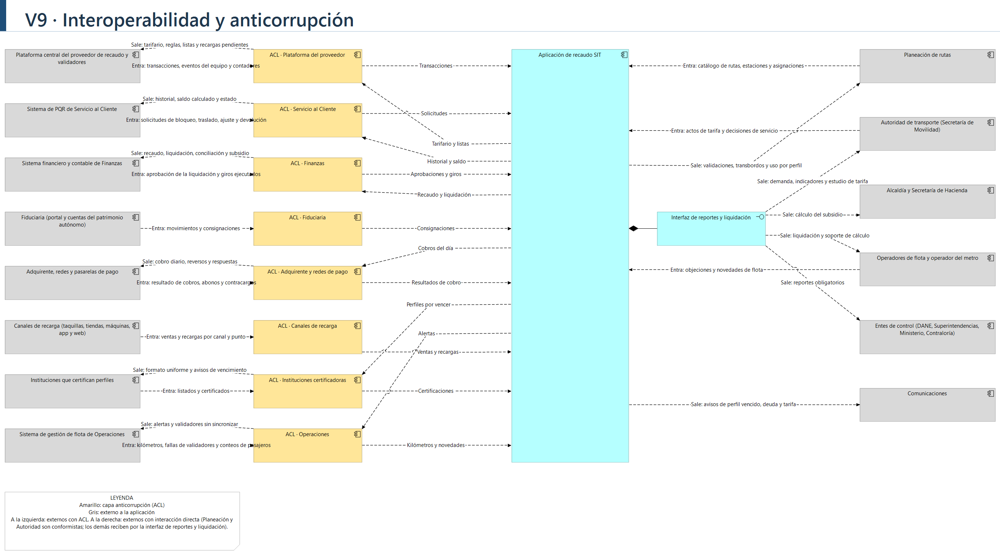

**Análisis.** La vista tiene los 14 externos de la tabla de servicios externos, uno por fila, con la dirección de cada intercambio escrita en el flujo ("Entra" y "Sale" se miran desde la aplicación). Ocho tienen una capa anticorrupción (los componentes cuyo nombre empieza por ACL): la plataforma del proveedor, el sistema de PQR, el sistema financiero, la fiduciaria, el adquirente y las redes de pago, los canales de recarga, las instituciones que certifican perfiles y el sistema de flota de Operaciones. En todos esos casos el modelo del otro lado es ajeno o no lo controlamos (formatos de Excel distintos, plataforma del proveedor, códigos del adquirente), y no queremos que contamine el lenguaje de la aplicación; la ACL traduce en los dos sentidos. Con los otros seis la relación es directa: Planeación y la autoridad de transporte son conformistas (adoptamos su catálogo de rutas y sus actos de tarifa tal como vienen), y a Hacienda, los operadores, los entes de control y la propia autoridad el software les entrega lo suyo por una sola interfaz de reportes y liquidación, que es el lenguaje publicado del lado nuestro. Comunicaciones solo recibe avisos.

**Decisiones.** La integración más crítica, según la experta, es la de los validadores con la plataforma central, por eso es la que tiene el flujo en ambos sentidos con más detalle (transacciones hacia arriba, tarifario y listas hacia abajo). La vista tiene que coincidir con el mapa de contextos (V8) cuando se haga: un externo con ACL aquí debe aparecer con ese patrón allá.

## 8. Bounded Context Canvas
### V11 Bounded Context Canvas
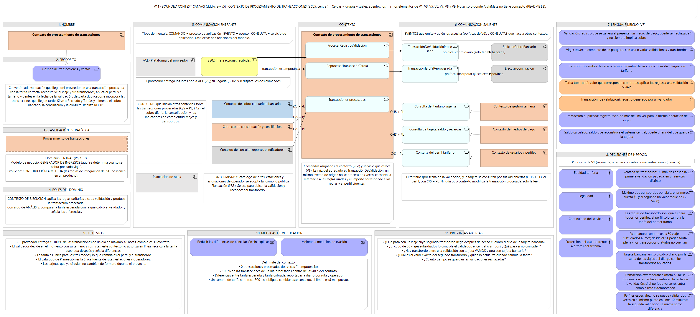

**Cómo lo resolvimos en ArchiMate (componente investigativo):** _…_

## 9. Decisiones y supuestos
### V10 Trazabilidad vertical
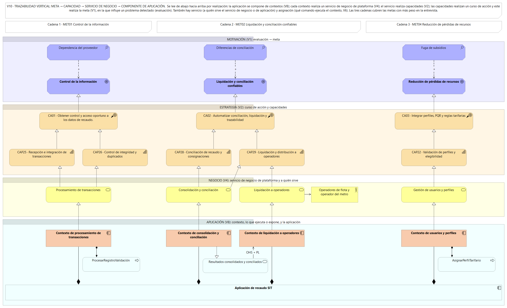

**Decisiones de diseño:** _…_
**Supuestos:** _…_

## 10. Tabla de aportes
| Integrante | Aportes (tareas del backlog) | Commits |
|---|---|---|
| | | |
